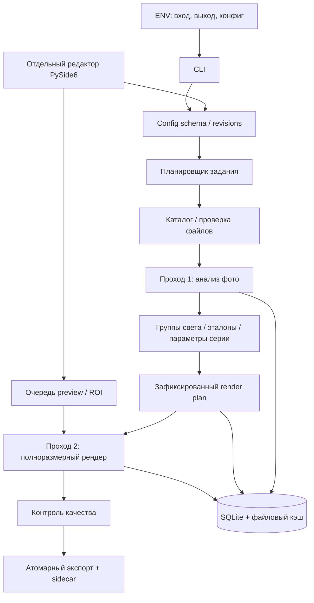

# PhotoEditor: архитектура локальной пакетной ретуши

Версия: 1.0. Дата: 19 сентября 2026. Целевая машина: Apple M2 Max, 32 GB unified memory, macOS, ARM64.
Статус: целевая архитектура. Текущий реализованный тракт версии CLI 0.3.3 помечен как пайплайн **«улучшение качества»** и описан в [current-pipeline.md](current-pipeline.md); история запусков — в [implementation.md](implementation.md). Не все возможности этой спецификации уже реализованы. Численные ограничения ниже — проектные настройки, если явно не указано иное.

## 1. Рекомендуемое решение

Создать независимое Python-ядро, пакетный CLI и отдельное настольное приложение на PySide6. Ядро выполняет одинаковый граф обработки для CLI, предпросмотра и финального экспорта. Модели определяют области обработки; изменения пикселей преимущественно выполняются детерминированными алгоритмами на исходном разрешении.

Базовый стек: Python 3.11 как стартовый кандидат для проверки совместимости ARM64-зависимостей, uv, Pydantic v2, ruamel.yaml, pyvips/libvips, LittleCMS, rawpy/LibRaw, NumPy, OpenCV, MediaPipe Tasks, PySide6, SQLite. Для дополнительных моделей — ONNX Runtime с CoreML Execution Provider или PyTorch MPS после проверки конкретной модели. Версии фиксировать lock-файлом по результатам технического прототипа.

Главный принцип: уменьшенное изображение используется для анализа, но не становится исходником финальной фотографии. Нельзя обработать фотографию целиком в 1024 px, затем увеличить её обратно и назвать это сохранением качества.

### Что значит «без потери качества»

Гарантировать неизменность пикселей при ретуши невозможно. Рабочий контракт:

- оригиналы никогда не перезаписываются;
- полное разрешение сохраняется, кроме явно выбранного resize/crop;
- цветовые операции выполняются в float32, без промежуточного JPEG;
- мастер экспортируется в 16-bit TIFF с lossless ZIP/LZW и встроенным ICC;
- JPEG — отдельная производная для просмотра/публикации: даже quality=100 не является lossless;
- поры, волосы, ресницы и мелкие детали сохраняются настолько, насколько допускает выбранная ретушь; результат проверяется на масштабе 100%;
- пересвеченные до полного клиппинга участки не содержат исходной текстуры: её нельзя достоверно восстановить;
- 16-bit TIFF из 8-bit JPEG не возвращает утраченную информацию, но предотвращает повторные потери от JPEG-кодирования.

### Противоречие требований о пропорциях

Геометрическое сужение лица или тела изменяет пропорции по определению. Предусмотреть два раздельных режима:

1. `preserve_geometry`: мягкое моделирование объёма светом, без перемещения пикселей. Это основной режим; визуальный эффект стройности ограничен.
2. `controlled_warp`: явная деформация контура лица/тела. Центральные черты лица закрепляются, но полное сохранение пропорций уже не обещается. По умолчанию выключен.

Схема конфигурации должна отклонять одновременные `preserve_geometry=true` и включённый геометрический warp. Световая ретушь тоже может изменить восприятие внешности: её сила ограничивается отдельно.

## 2. Архитектура и границы компонентов



| Компонент | Ответственность |
|---|---|
| `config` | Pydantic-модели, JSON Schema, миграции, диапазоны, cross-field проверки |
| `catalog` | Сканирование, хеши, EXIF/ICC, ориентация, связь RAW+JPEG |
| `decode` | Декодирование, RAW development, преобразование цвета |
| `analysis` | Landmarks, маски, статистика, confidence, признаки сцены |
| `collection` | Группы света, эталоны, согласование параметров |
| `engine` | Граф операторов, region/tile processing, зависимости кэша |
| `effects` | Цвет, свет, кожа, локальная ретушь, отдельный warp |
| `models` | Адаптеры runtime, загрузка локальных весов, hashes/licenses |
| `quality` | Метрики, обнаружение проблем, статусы review |
| `export` | TIFF/JPEG, ICC, metadata, sidecar, atomic rename |
| `jobs` | Очередь, отмена, resume, прогресс, лимиты памяти |
| `editor` | Каталог, сравнение, маски, настройки, очередь экспорта |

Ядро не импортирует UI. GUI запускает worker отдельным процессом через `QProcess`; команды/события — JSON Lines по stdin/stdout, диагностические логи — stderr. Передавать пути/идентификаторы, а не полноразмерные массивы через JSON. HTTP-сервер для первой версии не нужен.

Долгий GPU-инференс не всегда можно отменить немедленно: отмену проверять между стадиями и тайлами; устаревший preview помечать ненужным, результат не отображать. CLI остаётся пригодным для автоматизации без запуска GUI.

## 3. Контракт CLI и файлов

Обязательные переменные:

```bash
export PHOTO_INPUT_DIR='/path/to/incoming'
export PHOTO_OUTPUT_DIR='/path/to/processed'
export PHOTO_CONFIG_FILE='/path/to/preset.yaml'
photoeditor validate
photoeditor analyze
photoeditor render
photoeditor studio
```

Базовые команды реализованы в версии 0.2.3; фактический контракт и скрипты запуска см. в [current-pipeline.md](current-pipeline.md). `analyze` записывает план; `render` проверяет его актуальность и при необходимости выполняет анализ. Эффекты задаются только конфигом, чтобы ENV не создавали скрытых настроек. ENV определяют места хранения.

Правила входа:

- MVP: JPEG и RGB TIFF; RAW отдельным следующим этапом после проверки камер; PNG/HEIC — опциональные декодеры с отдельными тестами.
- EXIF Orientation применяется ровно один раз; все маски и координаты относятся к ориентированному изображению; экспорт имеет orientation=1.
- Учитывать не только расширение, но и содержимое. Повреждённый файл не останавливает всю коллекцию.
- Рекурсивный обход настраивается. Symlink по умолчанию не обходить. Запретить совпадающие или вложенные друг в друга input/output после `realpath`.
- Исходники хешировать потоково; перед рендером проверять, что вход не изменился после анализа.
- RAW+JPEG одной съёмки не объединять по одному имени автоматически: добавить явную политику выбора и проверку metadata.

Выходы:

```text
output/
  runs/<run_id>/
    manifest.json
    resolved-config.json
    collection-plan.json
    report.json
    images/<relative-parent>/<stem>__<source-id>.tif
    previews/<relative-parent>/<stem>__<source-id>.jpg
    sidecars/<source-id>.json
```

`source-id` — стабильный идентификатор из относительного пути и хеша содержимого. Существующий run не перезаписывать молча. Сначала писать временный файл на том же filesystem, проверить открытие/размеры/ICC, затем atomic rename. После сбоя незавершённый файл не считается результатом.

Sidecar содержит: исходный hash, effective config, версии движка/моделей и их hashes, runtime, группу света, reference ID, рассчитанные WB/EV/curve, ручные маски, QA, причины отключённых стадий, длительности. Параметры автоматической нормализации записываются явно.

Resume использует ключ результата, а не только наличие файла. Изменение эталона или состава группы инвалидирует collection plan и зависимые результаты. Добавление снимков в существующий frozen plan не меняет старые настройки автоматически: пользователь выбирает apply-existing-plan или reanalyze-collection.

Коды выхода: 0 — все файлы успешно обработаны, 2 — конфигурация/окружение неверны, 3 — часть файлов failed/needs_review, 4 — отмена, 5 — системная ошибка. Политика `needs_review` не должна маскироваться успешным экспортом.

## 4. Цветовой тракт

В MVP поддерживать SDR; HDR/HEIC gain map не сводить молча к SDR: явно отклонять либо выполнять выбранное преобразование с записью в отчёт.

1. JPEG/TIFF декодировать с учётом ICC. Если профиля нет, использовать настраиваемое предположение sRGB и записывать предупреждение. CMYK и экзотические TIFF либо конвертировать проверенным адаптером, либо отклонять.
2. Рабочее пространство: linear Rec.2020 RGB float32, D65. Использовать явные преобразования LittleCMS/матрицы и корректные профили; не заменять преобразование простым присваиванием ICC-тега. Профили включить в проект и зафиксировать хеши.
3. Значения вне [0,1] до выходного tone/gamut mapping сохранять; не выполнять ранний clamp. Alpha обрабатывать согласованно; цветовую математику проводить над straight RGB с корректным возвратом premultiplied alpha там, где нужно.
4. Экспозиция и смешивание света — linear light; локальные световые поля — log luminance; цветность/насыщенность — в явно указанном perceptual-пространстве с обратным преобразованием.
5. Ползунок «гамма» — творческая кривая средних тонов, не ICC transfer function. При значении 1 оператор нейтрален; точную формулу и порядок относительно контраста закрепить тестами.
6. Master: 16-bit TIFF, профиль ProPhoto RGB с корректной D50-адаптацией, мягкое gamut mapping. Для обмена можно выбрать Adobe RGB/sRGB; меньший gamut может потерять часть цветов. Для точного хранения float-результата предусмотреть отдельный 32-bit TIFF/EXR в будущем.
7. Preview/JPEG: корректное преобразование в sRGB; GUI переводит sRGB preview в профиль экрана через Qt color management. Проверить на wide-gamut дисплее; не делать двойную конверсию.

RAW: использовать rawpy/LibRaw с контролируемым WB, `no_auto_bright=True`, `output_bps=16`, линейной гаммой `gamma=(1,1)`; выходной gamut и его описание должны совпадать с декодером. LibRaw normalisation не отключать случайно вместе с auto-bright. Не применять повторно камерный WB и не считать RAW встроенный JPEG точным цветовым эталоном. Это стартовая конфигурация, качество demosaic/highlight recovery валидируется для каждой камеры. API параметров подтверждён в [документации rawpy](https://letmaik.github.io/rawpy/api/rawpy.Params.html).

libvips подходит для поточной обработки регионов и снижения числа полных копий; это не автоматическая гарантия тайлинга любого пользовательского NumPy-оператора. См. [libvips](https://www.libvips.org/) и [цветовые пространства libvips](https://www.libvips.org/API/8.17/libvips-colour.html).

## 5. Проход 1: анализ и выравнивание коллекции

Для каждого снимка:

- построить analysis proxy из того же декодера/цветового тракта, длинная сторона до 2048 px;
- вход моделей — отдельное sRGB представление с ожидаемой моделью нормализацией;
- обнаружить лица, позы, приблизительные маски кожи/волос/одежды;
- для маленьких лиц повторить анализ увеличенного crop из оригинала; простое увеличение маленького proxy не добавляет информации;
- вычислить robust percentiles luminance, долю clipping, статистику кожи и фона отдельно, neutral candidates, confidence и размер лица;
- оценить размытость/шум как признаки для ограничения ретуши, а не как основание автоматически усилить резкость.

### Формирование групп

Не сводить всю коллекцию к одной средней яркости. Белый фон, тёмная одежда, ночная сцена и студия имеют разные распределения. Группы задавать вручную либо предлагать по папке, времени съёмки, камере, фону, освещению и статистике. Автогруппировка — предложение с возможностью объединения/разделения в UI.

В каждой группе выбирается эталон либо robust medoid среди качественных кадров. Пользователь может зафиксировать глобальный look для всех групп, но экспозиция и WB согласуются внутри совместимых сцен. Силуэты и намеренно low-key/high-key кадры отмечаются как исключения.

### Алгоритм согласования

Для кадра i получить `s_i = weighted_median(log2(max(Y, epsilon)))` по валидным областям. Для каждой группы взять `s_ref` эталона. Начальная поправка:

```text
EV_i = clamp(strength * (s_ref - s_i), -max_ev, +max_ev)
RGB_out = RGB_in * 2^EV_i
```

Вес ROI зависит от уверенности и выбранного режима subject/scene/manual. Не подгонять кожу разных людей к единой светлоте: её собственный оттенок и тон являются частью внешности. Для последовательности одного человека допустим отдельный профиль, который пользователь назначает вручную; автоматическое распознавание личности не требуется.

Совместно уточнить ограниченные WB-gains и монотонную тоновую кривую: минимизировать robust расхождение выбранных статистик с эталоном, штрафы за clipping, большое изменение и скачки между соседними сопоставимыми кадрами. Сглаживание по времени действует только внутри группы и сбрасывается на смене света/камеры. Не использовать независимый histogram matching RGB-каналов: он искажает цвет кожи.

WB оценивать по нейтральным областям или явной точке; кожа сама по себе не является серой картой. При низкой уверенности оставить WB декодера/ручной WB. Смешанный свет корректировать мягкими локальными полями, без обещания точного восстановления физического освещения.

После анализа зафиксировать `collection-plan.json`. Все previews и финальные рендеры используют именно его; выбор 12 образцов для UI не должен пересчитывать статистику всей серии по этим 12 кадрам.

## 6. Проход 2: граф эффектов

Порядок фиксирован в engine version:

```text
decode → color transform → optional denoise → WB/exposure matching
→ low-frequency illumination → skin tone/specular correction
→ texture-aware smoothing → local blemish healing → optional contour light
→ optional geometry → creative curve/contrast/saturation
→ output gamut/tone mapping → optional output sharpening → encode
```

Маски вычисляются в исходных координатах. Геометрия выполняется после локальной ретуши; все вспомогательные карты, которые используются после неё, деформируются тем же полем. Глобальные параметры оцениваются по целому кадру, никогда отдельно по тайлам.

### Кожа лица и тела

Маска = семантическая вероятность кожи × confidence × ручные include/exclude. Исключить глаза, губы, ноздри, брови, волосы, бороду, контуры, украшения. Родинки, веснушки и татуировки сохранять по умолчанию; автоматика не может надёжно отличить их от дефектов. При необходимости пользователь добавляет protected regions.

Сглаживание: edge-aware decomposition/guided filter в нескольких масштабах; уменьшать неровность средних частот и цветовые пятна, сохранять высокочастотную фактуру. Не применять Gaussian blur поверх всей кожи. Радиусы задавать относительно ширины лица/тела, а не фиксированным числом пикселей proxy. Раздельные face/body strength, texture retention и protected-detail masks.

«Сохранить поры» не означает вернуть исходный шум: оценку шума учитывать отдельно, высокие частоты смешивать адаптивно. При неуверенной маске безопасное поведение — уменьшить эффект или пропустить локальную стадию с причиной.

### Блики и ровный свет

На коже выделять локальные яркие выбросы с учётом соседней яркости/цветности и градиентов. Уменьшать их мягкой маской и shoulder-кривой, сохраняя естественный объём. Белая одежда, зубы, глаза и блики украшений не должны попадать в эту маску.

Для выравнивания света оценить низкочастотное поле log luminance, затем ограниченно скорректировать его. Начальный предел локальной коррекции ±0.4 EV; степень смешивания настраивается. Не выравнивать лицо до плоской заливки, сохранить тени носа и скул. Полностью clipped highlights помечать; снижение их яркости не восстанавливает текстуру.

### Дополнительные beauty-эффекты

Все имеют `enabled` и `strength`: локальная коррекция красноты, смягчение теней под глазами, умеренное отбеливание зубов, снижение красноты склер, подавление отдельных мелких дефектов. Точные зубные/глазные маски обязательны; при их отсутствии эффект недоступен, а не применяется по приблизительному овалу.

Healing небольших дефектов — классический patch/clone по явно заданной области; автоматическое удаление родинок запрещено продуктовым default. Generative inpainting не включать в основной профиль.

### Стройность без warp

`contour_light`: очень мягкий dodge-and-burn вокруг боковых участков лица/силуэта. Сохраняется геометрия, но визуальная стройность не гарантируется для любого ракурса. Не выдавать этот режим за фактическое уменьшение ширины.

### Контролируемый warp

Отдельная стадия для пользователей, выбравших изменение геометрии. Landmarks задают anchors; сетка/MLS/ARAP деформирует боковые контуры, сохраняя закреплённые глаза, нос, рот и центральные отношения. Тело требует person mask + pose + уточнённый контур: 33 точки скелета сами по себе не определяют талию.

Стартовые лимиты смещения: лицо ≤1.5% ширины face bbox, тело ≤2% ширины person bbox. Это параметры продукта для калибровки, не гарантия незаметности. Не применять автоматически при сильном профиле, перекрытиях людей, неполном контуре или низком confidence.

Объединять все геометрические изменения в одно поле и делать один resample. Проверять положительный Jacobian без foldover, разумный локальный масштаб, отсутствие пересечения защищённых зон. Нужен halo с учётом максимального displacement и interpolation support.

Нельзя гарантировать неизменность фона при сужении силуэта: появляются области, которых не было видно. В строгом режиме блокировать warp при необходимости дорисовки/заметной деформации фона и отправлять фото на review. Для сложных фонов — ручной контроль, а не скрытое generative fill.

## 7. Модели и runtime на M2 Max

| Задача | Выбор | Использование и ограничение |
|---|---|---|
| Лицевые ориентиры | MediaPipe Face Landmarker | Базовый кандидат; 478 ориентиров, анализ crop; стартовать с CPU runtime, не предполагать автоматический доступ к ANE |
| Грубая кожа/волосы/одежда | MediaPipe SelfieMulticlass | Раздельные классы face-skin/body-skin; вход 256×256 недостаточен для точной ретуши краёв, обязательны crop/refinement/manual masks |
| Поза | MediaPipe Pose Landmarker Full | Ориентиры тела для анализа и опционального warp; проверять перекрытия и полноростовые фото |
| Уточнение лица | BiSeNet face parsing | Опциональный кандидат после bake-off на реальных фото; PyTorch MPS либо проверенный ONNX export; проверить отдельно права на checkpoint |
| Ручное уточнение силуэта | SAM 2.1 Hiera Tiny | Опциональные point/box prompts; выделяет область, но не определяет семантику «кожа»; вне обязательного MVP |
| Свет и beauty | Собственные классические операторы | Не требуют большой генеративной модели, дают воспроизводимый контроль и full-resolution output |

MediaPipe [Face Landmarker](https://ai.google.dev/edge/mediapipe/solutions/vision/face_landmarker), [Pose Landmarker](https://ai.google.dev/edge/mediapipe/solutions/vision/pose_landmarker) и [Image Segmenter](https://ai.google.dev/edge/mediapipe/solutions/vision/image_segmenter) предоставляют нужные типы результатов, но не гарантируют качество на произвольных студийных/групповых фотографиях. Семантическую маску низкого разрешения нельзя считать точной границей кожи; сохранять карту confidence, делать edge-aware upsampling и ручную коррекцию.

[BiSeNet face parsing](https://github.com/zllrunning/face-parsing.PyTorch) — кандидат, а не готовый протестированный компонент macOS. У [SAM 2](https://github.com/facebookresearch/sam2/blob/main/demo/backend/server/inference/predictor.py) поддержка MPS обозначена как предварительная; нужен CPU/reference comparison.

[PyTorch MPS](https://docs.pytorch.org/docs/main/notes/mps.html) использовать для прототипов моделей на GPU. [ONNX Runtime CoreML EP](https://onnxruntime.ai/docs/execution-providers/CoreML-ExecutionProvider.html) — вариант доставки проверенных моделей. При старте читать `get_available_providers()`, прогонять smoke inference, записывать фактический backend. Наличие CoreML EP не означает, что вся модель исполняется на ANE: смотреть partitioning, fallback и профиль исполнения. FP16 допустим для инференса после сравнения масок с FP32; цветовой master pipeline остаётся float32.

Не включать по умолчанию face restoration, super-resolution и diffusion relighting: они могут менять узнаваемые детали и фактуру. [IC-Light](https://github.com/lllyasviel/IC-Light) можно исследовать отдельно для творческого переосвещения, но не использовать как гарантированное сохранение личности/исходного качества. Поддержку и скорость MPS для этого экспериментального пути здесь не обещаем.

Реестр моделей: `id`, версия, URL происхождения, SHA-256, input shape/normalization, classes, runtime, license-code, license-weights, dataset notes, размер. Код и веса проверять отдельно. Модели заранее устанавливаются командой setup, обработка после установки работает offline. При отсутствии обязательной модели — явная ошибка; при отсутствии опциональной — недоступный эффект с понятной причиной.

## 8. Конфигурация

YAML и JSON описывают одну Pydantic-схему. Ниже проектируемый пример, не конфиг существующего приложения. `schema_version` обязателен; неизвестные ключи отклоняются. YAML загружать безопасно, без executable tags, ограничивать aliases/размер/глубину.

```yaml
schema_version: 1
profile: natural_series
input:
  recursive: true
  formats: [jpg, jpeg, tif, tiff]
  missing_icc: assume_srgb
  follow_symlinks: false
runtime:
  render_workers: 1
  analysis_workers: 2
  tile_size: 1024
  memory_soft_limit_gb: 18
  model_backend: auto_validated
  offline: true
color:
  working_space: linear_rec2020
  white_balance: {enabled: true, mode: group_reference, strength: 0.5}
  exposure: {enabled: true, offset_ev: 0.0}
  contrast: {enabled: true, amount: 0.08}
  saturation: {enabled: true, amount: 0.02}
  vibrance: {enabled: false, amount: 0.0}
  gamma: {enabled: true, value: 1.0}
collection:
  enabled: true
  grouping: manual
  target: subject_and_scene
  strength: 0.7
  max_correction_ev: 1.0
  freeze_plan: true
  groups:
    studio_a:
      files: ['studio_a/**']
      reference: 'studio_a/IMG_0012.jpg'
  unmatched: own_group
beauty:
  enabled: true
  preserve_geometry: true
  skin:
    enabled: true
    face_strength: 0.25
    body_strength: 0.18
    texture_retention: 0.9
    preserve_freckles: true
    preserve_moles: true
  specular: {enabled: true, strength: 0.25}
  even_light: {enabled: true, strength: 0.2, max_local_ev: 0.4}
  redness: {enabled: false, strength: 0.1}
  under_eye: {enabled: false, strength: 0.12}
  teeth: {enabled: false, strength: 0.1}
  sclera: {enabled: false, strength: 0.05}
  blemishes: {enabled: false, mode: manual_regions, strength: 0.3}
  contour_light: {enabled: false, strength: 0.1}
geometry:
  enabled: false
  face: {enabled: false, strength: 0.0, max_displacement_ratio: 0.015}
  body: {enabled: false, strength: 0.0, max_displacement_ratio: 0.02}
  protect_background: true
  reject_disocclusion: true
quality:
  uncertain_mask: skip_effect
  failed_checks: needs_review
  preserve_dimensions: true
export:
  master: {enabled: true, format: tiff, bit_depth: 16, compression: zip, icc: prophoto_rgb}
  delivery: {enabled: false, format: jpeg, quality: 95, icc: srgb}
  metadata: preserve_capture_strip_gps
  overwrite: false
preview:
  long_edge: 1600
  sample_count: 12
  full_resolution_roi: true
image_overrides: {}
```

Семантика параметров:

- `strength`, `texture_retention`: [0,1]; ноль strength нейтрален; texture_retention=1 сохраняет detail layer в пределах выбранной модели разложения, не гарантирует неизменность всех пикселей.
- `amount` contrast/saturation/vibrance: [-1,1], 0 нейтрален; gamma: [0.5,2], 1 нейтрален; ручная exposure: [-3,+3] EV.
- `max_correction_ev`: [0,2]; ограничивает только автоматику, ручной offset применяется дополнительно и тоже проверяется QA.
- displacement ratio измеряется относительно ширины соответствующего bbox; strength масштабирует допустимое поле, а не означает процент потери веса.
- глобальный `beauty.enabled=false` отключает все дочерние beauty эффекты; geometry контролируется отдельно и явно видна в UI.
- Порядок merge: defaults → preset → group override → image override → transient preview override. Map объединяются по ключам, массивы заменяются целиком; null разрешён только схемой. Resolved config сохраняется целиком.
- Профиль конфигурации не должен задавать произвольные Python-функции или shell commands.
- Если два glob присваивают разные группы одному снимку, validation требует явного выбора; не полагаться на случайный порядок.
- Идентификаторы людей и ручных регионов локальны снимку; для переноса настроек между людьми нужна явная пользовательская привязка.

Полная JSON Schema генерируется кодом и служит источником для UI. Она должна содержать единицы измерения, диапазон, default, описания, зависимости и признак experimental для каждого поля. Все параметры, включая runtime/export/QA, доступны в UI; специализированные панели дополняются advanced form и raw YAML editor. YAML-редактор сохраняет комментарии при возможности, но исполняется только валидированный объект.

## 9. Отдельный визуальный редактор

Рекомендация: PySide6 + Qt Widgets, отдельная команда/приложение `PhotoEditor Studio`. [Qt for Python](https://doc.qt.io/qtforpython-6/) предоставляет Python bindings; выбранные модули, упаковку и лицензию проверить перед распространением.

Экран:

```text
┌ Коллекция / группа / эталон      ┬ До | После / wipe / 100%          ┬ Настройки ┐
│ Группы света                    │                                 │ Цвет      │
│ Миниатюры с QA                   │ Основное фото + histogram       │ Свет      │
│ Образцы / все / требуют review   │ Маски / protected regions       │ Кожа      │
│                                 │                                 │ Геометрия │
├─────────────────────────────────┴─────────────────────────────────┴───────────┤
│ Контактный лист образцов: тёмные, светлые, разные ракурсы, разные группы       │
│ Config revision • preview status • сохранить preset • обработать коллекцию  │
└─────────────────────────────────────────────────────────────────────────────┘
```

Обязательные функции:

- выбор трёх путей и открытие YAML/JSON; UI создаёт тот же job specification, который CLI получает из ENV;
- формы для всех конфигурационных полей, toggle каждого эффекта, reset и bypass группы эффектов;
- синхронные before/after zoom и pan, wipe, 100% ROI, выделение clipping;
- выбор эталона по группе, назначение/исключение кадров, ручные WB/ROI;
- brush add/subtract/protect для масок с undo/redo; хранить в sidecar исходные координаты и размеры;
- показ уверенности маски, причины пропуска эффекта, проверка лица и тела отдельно;
- 12 образцов по умолчанию: распределённые по группам, крайние экспозиции, ракурсы, сложные маски, несколько пользователей закрепляют вручную;
- изменение настроек сразу показывает результат текущего кадра, затем обновляет контактный лист;
- сохранение preset отдельно от image overrides и job state; preview не перезаписывает сохранённый конфиг без Save;
- очередь full-resolution export, cancel/resume, список ошибок, повторный рендер выбранного кадра.

Три уровня preview: thumbnails 320 px; интерактивный proxy 1600 px; точный crop 100% из full-resolution engine. Первые два могут отличаться от финальной микротекстуры и помечаются как preview. Для финальной проверки использовать ROI с контекстным halo и теми же замороженными глобальными параметрами; нельзя повторно вычислять WB/нормализацию только по crop.

Debounce ползунков 150–250 ms, preview request содержит `revision_id`. Результат устаревшей revision не отображается. Изменение цвета не перезапускает landmarks; изменение smoothing не пересчитывает каталог. Смена эталона инвалидирует зависимые кадры группы. Undo возвращает параметры и ссылки на masks, а не копирует фотографии.

## 10. Память, тайлы и быстродействие

M2 Max использует общую память CPU/GPU. Для RGB float32 один 24 MP буфер занимает примерно 288 MB, 60 MP — 720 MB; шесть полных 60 MP буферов — около 4.32 GB без масок, моделей и накладных расходов. Не держать всю коллекцию в RAM.

Начальный бюджет процесса: soft limit 18 GB, ориентир peak ≤22 GB, оставить запас системе/UI. Это целевые ограничения; измерять process footprint, memory pressure, GPU allocations и swap. Начать с одного render worker, одного активного ML inference, максимум двух лёгких analysis workers. Не запускать несколько процессов с копиями одинаковых весов на GPU.

Тайлы 1024×1024 — стартовая настройка. Halo вычисляется из радиусов всех операторов, поддержки resampling и максимального warp, а не задаётся навсегда равным 64 px. При свёртках учитывать накопленный support графа. Guided/local filters должны иметь одинаковый контекст по обе стороны шва. Глобальное illumination field вычисляется один раз на полном proxy и переносится в координаты оригинала.

В MVP допускается full-frame путь для умеренных размеров с измеренным лимитом; для 45–60 MP и выше нужен region API, который не материализует несколько полных NumPy-копий. RAW decoder может потребовать полный буфер — включить это в memory budget.

Кэш: metadata, analysis, masks, global fields, preview, при необходимости промежуточные tiles. Ключ: source hash + версия декодирования/профиля + модель/weights hash + параметры конкретной стадии + upstream keys + engine version + backend/precision. Политика LRU с дисковой квотой, pinned данные активного run; очистка кэша не удаляет оригиналы и masters.

При OOM: освободить временные буферы, уменьшить tile и concurrency, повторить один раз; при повторной ошибке завершить кадр failed. Не уменьшать размер конечного изображения незаметно. CPU fallback фиксируется в отчёте, не объявляется идентичным MPS без tolerance tests.

Целевые UX-бюджеты после прогрева: цветовой proxy ≤0.5 s, beauty proxy ≤2 s. Это ориентиры разработки, не обещание скорости. Время full-resolution экспорта установить по бенчмаркам на 24/45/60 MP; измерять cold/warm, p50/p95, peak memory и долю fallback. Не экстраполировать опубликованные мобильные benchmarks MediaPipe на M2 Max.

## 11. Контракты реализации и структура проекта

```text
PhotoEditor/
  pyproject.toml
  uv.lock
  apps/local-editor/src/photoeditor/
    cli.py
    config/ catalog/ decode/ analysis/ collection/
    engine/ effects/ models/ quality/ export/ jobs/
    editor/
  configs/natural.yaml
  schemas/config.schema.json
  model_registry/models.lock.json
  tests/unit/ integration/ golden/ performance/
  docs/
```

Базовые контракты:

```python
analyze(source: SourceRef, config: AnalysisConfig) -> AnalysisArtifact
plan_collection(items: list[AnalysisArtifact], config: CollectionConfig) -> CollectionPlan
resolve_recipe(source_id: str, plan: CollectionPlan, config: Config) -> RenderRecipe
render(recipe: RenderRecipe, region: Region | None, scale: float) -> RenderArtifact
validate_result(before: SourceRef, after: RenderArtifact, recipe: RenderRecipe) -> QAReport
```

Типы выше — концептуальный API. `RenderRecipe` неизменяемый, содержит hashes upstream assets, пространство/единицы координат, параметры эффектов и geometry policy. `Region` задаётся в ориентированных исходных пикселях. Маски несут affine mapping crop→source и valid rect. Оператор объявляет inputs, color space, required halo, resolution policy, memory estimate, version и deterministic scope.

События worker: `job_started`, `analysis_ready`, `preview_ready`, `progress`, `image_completed`, `image_needs_review`, `error`, `cancelled`, `job_completed`. Каждое содержит job_id, revision_id, source_id при наличии. После `preview_ready` UI читает кэш-файл. SQLite хранит состояния через транзакции, единственный writer — job coordinator.

## 12. Проверка качества и приёмка

Подготовить 100–200 разрешённых к использованию фотографий: разные оттенки кожи, возраст, лица/полный рост, очки, борода, татуировки, сложный фон, группа людей, профиль, перекрытия, холодный/тёплый/смешанный свет, клиппинг, шум, маленькие лица и кадры без людей. Отдельно набор одного человека в разных условиях. Персональные фото не отправляются в облако и не используются для обучения автоматически.

| Проверка | Критерий |
|---|---|
| Размер/ориентация | Соответствуют ориентированному оригиналу, если resize/crop выключены |
| No-op операторов | Float pipeline с выключенными эффектами совпадает с baseline того же decode/color/export пути в установленной численной погрешности |
| Identity copy | Для полной побитовой идентичности отдельный режим копирования оригинала; перекодирование не считается identity copy |
| Тайлы | Нет видимых швов; tiled/full reference float32 отличаются не более согласованного допуска на тестовом диапазоне, стартовый ориентир max abs 1e-4 |
| Цвет | ICC встроен; тестовые patch values соответствуют reference transform; отсутствие двойной гаммы |
| Геометрия off | Render graph не содержит spatial warp; тест координатной сетки подтверждает отсутствие смещений |
| Геометрия on | Нет foldover, displacement в лимите, protected anchors стабильны; визуально проверены фон и контуры |
| Маски | Нельзя менять волосы/глаза/одежду локальным skin smoothing; protected regions не затронуты локальными beauty-стадиями |
| Серия | На сопоставимых кадрах после правки уменьшается разброс яркости/WB; тёмная кожа и намеренный low-key не «нормализуются» до светлой кожи |
| Preview | Full-resolution ROI совпадает с соответствующим crop экспорта после одинакового display transform в заданной погрешности |
| Восстановление | Прерывание на любой стадии не создаёт ложный complete; resume выдаёт тот же recipe/result в рамках backend tolerance |
| Надёжность | Повреждённый файл изолирован, недостаток диска обнаружен, originals hashes неизменны |

Стартовые QA-ориентиры для сопоставимых контролируемых сцен: медианная ошибка экспозиции относительно выбранного эталона ≤0.15 EV; прирост доли clipped pixels >0.2 процентного пункта вызывает review. Эти пороги необходимо калибровать; они не универсальны для всех сюжетов.

Измерение высокочастотной энергии кожи — только индикатор потери деталей: шум тоже повышает её. SSIM/PSNR к оригиналу не являются метрикой качества beauty, поскольку желательное изменение снижает сходство. Нужна визуальная оценка 100% crops до/после и контактного листа серии; регрессионные golden fixtures дополняются экспертной приёмкой.

QA выполняется после финального color/export преобразования, а также выборочно до него: иначе можно пропустить clipping на экспорте. Ошибки high-confidence geometry и foldover блокируют соответствующую стадию; неуверенные локальные маски пропускают эффект; повреждённый файл → failed; всё отражается в report и UI.

## 13. План разработки

1. **Технический прототип.** Проверить ARM64 wheels и совместимость Python; decode JPEG/TIFF/RAW, ICC roundtrip, MediaPipe CPU, BiSeNet/SAM только при необходимости, MPS/CoreML smoke tests. Измерить 24/45/60 MP. Итог: lock-файл, таблица работающих runtime, reference fixtures. Если optional модель не работает, основной pipeline не зависит от неё.
2. **Ядро цвета и CLI.** ENV, схема, scan, ICC, float graph, TIFF export, atomic writes, manifest/resume. Приёмка: no-op baseline, цветовые patches, originals unchanged.
3. **Нормализация коллекции.** Двухпроходный план, ручные группы/эталоны, robust EV/WB, frozen plan, отчёт. Приёмка: согласованная серия без унификации разных тонов кожи.
4. **Natural beauty.** Landmarks, face/body masks, protected zones, smoothing/specular/even light, conservative fallback. Приёмка: естественная фактура и отсутствие утечек маски.
5. **Редактор.** Все поля schema, before/after, контактный лист, ROI, revision/cancel, сохранение preset, batch queue. Можно начать shell редактора параллельно разработке ядра, но он использует то же API.
6. **RAW и расширения.** Матрица камер, мелкие локальные эффекты, optional parsing/refinement. Геометрический warp выпускать отдельной возможностью только после тестов фона/идентичности.
7. **Оптимизация и упаковка.** Профилирование → точечное ускорение CoreML/Metal по реальным bottlenecks, `.app`, локальные модели, воспроизводимая установка и документация.

MVP включает CLI, YAML/JSON, JPEG/TIFF, единый цвет/свет серии, мягкую face/body beauty, TIFF master, редактор и accurate ROI. Геометрическое похудение, RAW и генеративное переосвещение не должны задерживать базовый MVP; первые два остаются отдельными запланированными возможностями, последнее — исследовательским расширением.

## 14. Решения, требующие проверки на исходных фото

Архитектуру можно реализовывать без этих ответов, используя указанные defaults. До калибровки качества уточнить: камеры/RAW-форматы, типичные мегапиксели и размер коллекции, один или несколько людей на фото, желаемый delivery format, примеры допустимой силы beauty и нужен ли вообще geometry mode. До этих проверок не обещать фиксированный FPS, универсальное удаление бликов или автоматическую идеальную ретушь любого кадра.

Проверенные первичные источники приведены рядом с соответствующими техническими решениями. Предложенные алгоритмы, ограничения, схема и критерии приёмки являются проектными решениями этой спецификации, а не заявлениями производителей моделей.


## 15. E2E: студийная обработка тестовой серии

Подробный приёмочный сценарий: [E2E-01 — единый студийный свет](e2e-studio-series.md). Вход: `/Users/freelancer/Documents/PhotoEditor/e2e/input`; выход: `/Users/freelancer/Documents/PhotoEditor/e2e/output`. Цель: шесть качественных портретов с мягким согласованным светом, чистой естественной кожей, более стройным видом, хорошей резкостью и сохранением узнаваемых черт каждого человека.

Для этого сценария геометрическая коррекция включается явно с защитой центральных черт лица; полное сохранение всех пропорций не заявляется. Предусмотрены полноразмерные JPEG в `runs/<run_id>/delivery/` дополнительно к TIFF masters и previews, общий look для разных групп света, per-person overrides, output sharpening и раздельная техническая/визуальная приёмка. Эти расширения схемы требуют реализации. Синтетические входы увеличены до 24 Мп и не заменяют проверку на нативных высокодетальных фотографиях. Технический прогон реализован; результаты и ограничения визуальной приёмки см. в [implementation.md](implementation.md).
