# PhotoEditor 0.3.3: улучшение качества

**Статус:** текущий рабочий пайплайн улучшения качества фотографий.

Он отвечает за выравнивание света и цвета серии, естественную ретушь, контролируемую коррекцию контуров, повышение резкости и условное восстановление нерезких лиц с сохранением идентичности через ArcFace gate.

Дата актуализации: 20 сентября 2026. Целевая машина: Apple M2 Max, 32 GB unified memory, macOS ARM64.

Этот документ описывает фактически реализованный тракт. Целевая архитектура и будущие расширения находятся в [architecture.md](architecture.md), E2E-критерии — в [e2e-studio-series.md](e2e-studio-series.md), история проверок — в [implementation.md](implementation.md).

## 1. Назначение и контракт

PhotoEditor — локальный пакетный редактор портретных серий. Он:

- нормализует экспозицию и цвет серии;
- выравнивает крупные и локальные перепады света на лицах;
- ретуширует кожу, блики и локальную красноту;
- контролируемо повышает резкость;
- обнаруживает нерезкие лица и включает для них отдельную предобработку;
- опционально деформирует контуры лица и явно размеченные области тела;
- экспортирует полноразмерный 16-bit TIFF, delivery JPEG, previews и QA-артефакты;
- никогда не перезаписывает входные фотографии.

Обработка работает локально. Основной runtime не отправляет фотографии во внешние сервисы.

## 2. Запуск

Основной E2E:

```bash
cd /Users/freelancer/Documents/PhotoEditor
./run-e2e.sh
```

Собственная коллекция:

```bash
export PHOTO_INPUT_DIR='/absolute/path/input'
export PHOTO_OUTPUT_DIR='/absolute/path/output'
export PHOTO_CONFIG_FILE='/absolute/path/config.yaml'
./run.sh validate
./run.sh render
```

Повторный запуск без повторного pixel render:

```bash
./run.sh render --resume
```

Другие команды:

```bash
./run.sh analyze
./run.sh preview --image relative/path.jpg
./run.sh schema
./run.sh setup-models
./scripts/setup.sh --studio
./run.sh studio
```

Первый setup создаёт `.venv`, устанавливает зависимости из `requirements.lock`, скачивает официальные MediaPipe weights и проверяет SHA-256. Поддерживаются Python 3.10–3.12. Основной проверенный runtime — MediaPipe 0.10.21 и OpenCV CPU.

## 3. Схема данных

```mermaid
flowchart LR
    ENV[ENV paths] --> VALIDATE[Validation and scan]
    VALIDATE --> ANALYZE[Proxy analysis]
    ANALYZE --> PLAN[Frozen collection plan]
    PLAN --> MAPS[Face, skin and light maps]
    MAPS --> RENDER[Full-resolution tiled render]
    RENDER --> QA[Metrics and blur gate]
    QA --> EXPORT[TIFF, JPEG, previews, sidecars]
    EXPORT --> PUBLISH[Edited JPEGs in output root]
    QA -->|soft faces| RECOVERY[Conditional face recovery]
    RECOVERY --> RENDER
    QA -->|soft faces only| CODEFORMER[CodeFormer fidelity candidates]
    CODEFORMER --> ARCFACE[ArcFace identity and quality gate]
    ARCFACE -->|accept or rollback| GLARE[Final full-resolution face highlight cleanup]
    GLARE --> WB[Post white balance and highlight shoulder]
    WB --> COLOR[Adaptive face color finish]
    COLOR --> EXPORT
```



Прокси применяется только для анализа. Финальные пиксели всегда читаются из полноразмерного входа.

## 4. Валидация и каталог

`scan()` принимает JPEG, PNG и RGB TIFF согласно `input.formats`. Symlinks игнорируются. Input, output и их вложенные варианты не могут совпадать. Для каждого файла вычисляются:

- относительный путь;
- SHA-256 содержимого;
- стабильный `source_id` из пути и SHA-256.

Конфиг валидируется Pydantic-моделями с `extra=forbid`. Неизвестные ключи, YAML aliases, повторяющиеся ключи, NaN, некорректные диапазоны и конфликт `preserve_geometry=true` с `geometry.enabled=true` отклоняются до обработки.

## 5. Декодирование и цвет

- EXIF Orientation применяется один раз.
- 8-bit вход с ICC преобразуется в sRGB.
- Файл без ICC принимается как sRGB только при `missing_icc: assume_srgb`, с предупреждением в отчёте.
- 16-bit interleaved RGB TIFF sRGB читается без промежуточного перехода в 8-bit.
- CMYK без профиля, alpha, HDR, multipage TIFF и неподдержанный high-bit ICC отклоняются.
- Рабочая математика выполняется в float32: экспозиция — в linear sRGB, perceptual effects — в encoded sRGB.
- До beauty-прохода применяется непрерывный highlight shoulder; он ограничивает новые выбитые света.

RAW, wide gamut Rec.2020/ProPhoto и сохранение EXIF пока не реализованы.

## 6. Проход анализа

Для каждого кадра строится proxy с длинной стороной `runtime.analysis_long_edge`, в E2E — 1600 px. MediaPipe Face Landmarker выполняет поиск лиц на полном proxy и crop нескольких масштабов. Selfie Multiclass Segmentation формирует карты:

- `face_skin`;
- `body_skin`;
- `face_oval`;
- `person`;
- `protected` для глаз, бровей и губ;
- luminance proxy.

В статистику попадают bbox, landmarks, median linear luminance, clipping и число лиц. Analysis cache хранится в `output/.cache` как JSON + compressed NPZ и проверяется checksum.

## 7. Нормализация коллекции

После анализа всех кадров вычисляется frozen plan. Для каждого кадра берётся медиана luminance лиц; при отсутствии лиц — медиана сцены. Target задаётся:

- `mode: target` — через `target_face_luma`;
- `mode: median` — медианой доступных кадров.

Поправка:

```text
EV = clamp(log2(target / metered) * strength,
           -max_correction_ev,
           +max_correction_ev)
```

E2E preset использует target 0.50, strength 0.74 и ограничение 1.8 EV. Это снижает белёсость светлых лиц и не вытягивает чрезмерно шум и серую дымку тёмных кадров.

Изменение входов, конфига, версии движка или hashes моделей инвалидирует plan. `--resume` использует только совпадающий `plan_hash` и проверенные hashes выходов.

## 8. Полноразмерный render

Кадры обрабатываются последовательно, тайлами 768 px. Halo рассчитывается из радиусов фильтров, поэтому границы тайлов не должны быть видны. Выходной буфер — uint16 RGB.

Порядок операций:

1. декодирование tile и перевод в linear sRGB;
2. WB gains и общая EV-коррекция;
3. low-frequency световое поле;
4. highlight shoulder;
5. перевод в encoded sRGB;
6. условное восстановление деталей нерезких лиц;
7. локальное выравнивание света и мягкая тоновая компрессия;
8. подавление specular highlights;
9. локальные красные дефекты и общая краснота;
10. guided skin smoothing с возвратом высоких частот;
11. saturation, contrast и gamma;
12. thresholded sharpening с защитой кожи и пересветов;
13. явные blemish circles;
14. единый geometry resample, если включён.

### Свет лица

`prepare_maps()` строит двухмасштабное log-luminance поле: near blur сохраняет форму, far blur ослабляет широкие солнечные тени. Коррекция ограничена `max_local_ev`. Небольшой общий key-light gradient согласует направление света между сценами.

Внутри face oval дополнительно применяется локальное отношение far/near luminance. Притягивание к target слабое, ограничено диапазоном 0.88–1.16 и почти отключается в светах. Маска растушёвана и ограничена person mask, чтобы избежать светлого ореола у волос.

### Кожа

Skin smoothing использует guided filter. `texture_retention` возвращает fine layer; значение 1.0 сохраняет его полностью. Глаза, брови и губы защищены. Automatic blemish correction меняет только локальные красные отклонения относительно размытой chroma-базы. Родинки и устойчивые черты автоматически не удаляются.

### Геометрия

Face warp действует на боковые контуры, защищает центр лица и ограничен `max_face_displacement`. Body warp работает только внутри явных `body_regions`. Проверка градиента displacement снижает силу, если локальный Jacobian становится опасным. Любая применённая геометрия получает `needs_review`.

## 9. Blur-gate и частная предобработка

Каждый face crop приводится к 512×512. Метрика — variance of 3×3 Laplacian. В E2E порог равен 0.002.

Если входное лицо ниже порога, `prepare_maps()` создаёт отдельную `recovery_mask`, более узкую, чем relight mask. До beauty-сглаживания применяются:

- fine residual от малого Gaussian blur;
- mid-scale residual от более крупного Gaussian blur;
- noise threshold 0.0025;
- ограничение амплитуды через `max_detail_gain`;
- highlight guard;
- мягкая маска, не затрагивающая фон и границу волос.

На резких лицах стадия полностью нейтральна. После render blur измеряется повторно; в `report.json` пишутся `face_sharpness` и `min_face_sharpness`. Если результат остаётся ниже порога, добавляется `face_blur_detected` с параметрами рекомендуемого восстановления.

Для `03_family_backlight.jpg` действует override:

```yaml
beauty:
  skin: {face_strength: 0.12, texture_retention: 1.0}
detail:
  sharpening: {strength: 0.68}
  face_recovery: {strength: 0.9, max_detail_gain: 0.06}
```

В прогоне `20260920-000812-870b7733` sharpness ребёнка вырос с 0.000869 до 0.001321, взрослых — с 0.000868 до 0.000918 и с 0.001343 до 0.001430. Предобработка улучшает существующие границы, но не может восстановить отсутствующие поры, ресницы или фактуру.

## 10. CodeFormer и ArcFace gate для остаточной нерезкости

CodeFormer установлен отдельно в `.models/CodeFormer`, runtime — `.venv-codeformer` на Python 3.10. Установка воспроизводится `./scripts/setup-codeformer.sh`; базовый setup не скачивает генеративные веса. Этап включается через `detail.blur_detection.auto_restore` и запускается после детерминированного full-resolution render.

Для каждого кадра ниже blur-threshold выполняется один локальный модельный проход:

- RetinaFace ResNet-50 на полноразмерном delivery JPEG и aligned crops 512×512;
- один загруженный CodeFormer строит кандидаты `fidelity_candidates`;
- ArcFace IR-SE50 сравнивает embedding оригинала, кандидата и смешанного crop;
- кандидат обязан пройти `min_identity_similarity`, дать не менее 5% прироста sharpness и не увеличить clipping более чем на 0.02;
- прошедший crop смешивается с исходным с коэффициентом `blend` и вклеивается через parsing-mask;
- отклонённое или достаточно резкое лицо остаётся без модельных изменений;
- решение по каждому лицу, fidelity и метрики пишутся в `report.json`, sidecar и `restoration-response.json`.

CodeFormer генерирует правдоподобные детали и может менять идентичность даже при высоком fidelity. Поэтому он запускается только после blur-gate, защищён ArcFace и никогда не изменяет 16-bit master. При сбое runtime, отсутствии весов или непройденной проверке публикуется обычный delivery JPEG. Это сохраняет лицо, но ArcFace не доказывает историческую достоверность синтезированной мелкой фактуры.

### Финальный баланс белого, очистка бликов и цвет кожи

После решения CodeFormer/ArcFace пайплайн проходит по всем найденным лицам в полном разрешении. Маска выбирает только кожу, которая одновременно ярче заданного порога и своей сглаженной окрестности. Широкие солнечные пятна определяются относительно распределения яркости конкретного лица. Глаза, брови и губы защищены; изменение ограничено `max_reduction`, граница маски растушёвывается. После очистки `post_white_balance` оценивает нейтральные средние тона кадра, ограниченно корректирует каналы в linear light и плавно сжимает яркие области до заданного headroom. Насыщенные цвета и выбитые света не участвуют в оценке. Затем `face_color_finish` оценивает цвет нормальных средних тонов каждого лица и возвращает серым или выбеленным участкам согласованную насыщенность и теплоту без изменения яркости. Глаза, брови и губы защищены. Готовый файл записывается в `finished/` и имеет приоритет при публикации. Настройки находятся в `beauty.highlight_cleanup`, `beauty.post_white_balance` и `beauty.face_color_finish`.

## 11. QA и статусы

Для кадра записываются:

- доля клиппинга до/после;
- median face luma до/после;
- P90–P10 spread освещения лица;
- число лиц;
- sharpness каждого лица;
- эффективный config, EV, runtime и hashes моделей.

Причины `needs_review`:

- число лиц не совпало с `expected_faces`;
- вырос clipping;
- лица не найдены;
- geometry применена или была ограничена;
- источник уже содержит необратимый clipping;
- лицо осталось ниже blur threshold.

Код выхода 3 означает `failed` или `needs_review`, хотя файлы могут быть корректно сохранены. Технический PASS и визуальный PASS разделены.

## 12. Выходные файлы

```text
output/
  01_window_overexposure.jpg
  02_low_light.jpg
  03_family_backlight.jpg
  ...                         # актуальные delivery JPEG
  latest.json
  collection-plan.json
  .cache/
  runs/<run_id>/
    images/*.tif              # 16-bit sRGB ZIP master
    delivery/*.jpg            # базовый JPEG quality 95, 4:4:4, sRGB ICC
    restored/*.jpg            # принятые CodeFormer результаты
    finished/*.jpg            # финальная очистка бликов, источник публикации
    previews/*.jpg
    review/contact-sheet-before-after.jpg
    review/faces/*__before.jpg
    review/faces/*__after.jpg
    sidecars/*.json
    manifest.json
    resolved-config.json
    collection-plan.json
    report.json
    acceptance.json
```

После завершения пайплайн атомарно публикует `finished/*.jpg` в корень output под исходным именем. Если финальный этап выключен или завершился ошибкой, используется `restored/*.jpg`, затем `delivery/*.jpg`. История run не перезаписывается.

## 13. Редактор

PySide6 Studio запускается отдельным процессом. Реализованы список входов, YAML editor, validation/save, before/after proxy, preview выбранного кадра, batch и cancel. Несохранённый конфиг передаётся worker через временный снимок. После изменения конфига старый preview считается устаревшим.

Не реализованы интерактивные кисти, 100% ROI, визуальные ползунки всей схемы и production color proofing.

## 14. Текущий E2E

Последний полностью автоматический run 0.3.3: `e2e/output/runs/20260920-023305-4db99358`.

- 6 фотографий 6000×4000;
- 10 найденных лиц;
- 6 TIFF masters и 6 delivery JPEG;
- 22 автоматических теста: PASS;
- `scripts/verify-e2e.py`: technical PASS;
- выходной clipping: 0;
- готовые JPEG опубликованы прямо в `e2e/output`;
- у двух нерезких лиц `03_family_backlight.jpg` sharpness вырос до 0.005110 и 0.003784; ArcFace после смешивания — 0.976 и 0.978;
- визуальный статус остаётся `NEEDS_REVIEW` из-за исходного clipping, geometry и нерезких исходных лиц.

## 15. Ограничения

- Детерминированная резкость не создаёт отсутствующие детали.
- Генеративное восстановление может изменить идентичность.
- Полностью выбитые света JPEG не восстанавливаются достоверно.
- Нет RAW, HDR, wide gamut, automatic WB и EXIF copy.
- Body regions размечаются вручную; pose-aware slimming отсутствует.
- ArcFace снижает риск изменения личности, но не гарантирует подлинность восстановленной микрофактуры.
- Full-resolution вход, выход и optional warp buffer находятся в памяти; это tiled effects pipeline, но не полностью out-of-core decoder.

## 16. Проверка

```bash
cd /Users/freelancer/Documents/PhotoEditor
.venv/bin/python -m pytest -q
.venv/bin/python scripts/verify-e2e.py
./run.sh render --resume
```

Ожидаемый результат текущей версии: 22 passed, technical E2E PASS, 6 cache hits при resume. Визуальное решение принимается по contact sheet и 100% face crops.
