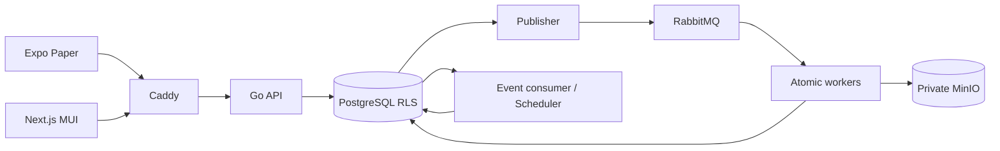

# 01. Архитектура и решения ADR

## Компоненты и дерево

```text
backend/cmd/photo/{main.go}                 # api|scheduler|publisher|event-consumer|mail-worker|maintenance
backend/internal/{auth,tenant,project,collection,style,run,review,upload,download,storage,audit}
backend/internal/{httpapi,db,queue,workflow,config,telemetry}
backend/db/{migrations,queries}; backend/internal/db/generated
workers/photo_worker/{runtime,contracts,io,models,operations,algorithms,cli}
apps/photographer/{app,src}                 # Expo Router / Paper
apps/portal/{app,src}                       # Next App Router / MUI
packages/{api-client,contracts,locales,design-tokens}
resources/{models.lock.json,profiles.lock.json,profiles,licenses}
deploy/{compose.yaml,profiles,Caddyfile,images,env.schema.json}
tests/{contract,integration,fault,security,numerical,visual,performance,fixtures}
```

Go net/http+chi, pgx/v5/sqlc/goose; Python 3.11/Pydantic/pika/psycopg/minio; PostgreSQL — единственный источник бизнес-состояния. Redis/Celery/workflow engine не вводятся. Одна Go-кодовая база, отдельные процессы с минимальными credentials. Portal не получает service DB/S3/AMQP credentials. API не выполняет численные операции.



## Принятые решения

| ADR | Решение и следствие |
|---|---|
| A01 — версия продукта | ТЗ 4.1 имеет приоритет над локальным desktop-проектом. CLI 0.3.3 — legacy, не база контрактов новых сервисов. |
| A02 — запись фото | AssetVersion immutable; любое редактирование создаёт новый asset/version и новую draft output collection. Публикация — отдельное решение, ссылки не наследуются. |
| A03 — item/version | Единственное поле `collection_items.asset_version_id`; `display_version_id/download_version_id` из общей таблицы ТЗ заменены ссылками на derivatives/presets той же версии. Нельзя выбрать другую правку при скачивании. |
| A04 — граница транзакций | SQL атомарен для metadata/outbox; S3 writes вне транзакции. Уникальные attempt keys + fenced commit + GC. Rabbit at-least-once, а не exactly-once вычисления. |
| A05 — hash | `config_hash=SHA256(JCS(style))`; импорт отдельно хранит `source_file_sha256`; экспорт — точные JCS UTF-8 bytes без newline. Так совместимы хеш канонического содержания и хеш выдаваемого файла (§13.1/37). |
| A06 — RLS | Разделить tenant api, global auth, portal restricted views/functions, worker function-only, scheduler/publisher maintenance роли. `FORCE RLS` на tenant tables; прямой runtime BYPASSRLS запрещён. |
| A07 — policy version | Любое изменение share permissions/expiry повышает policy_version и инвалидирует старые guest sessions; новый exchange исходного secret создаёт сессию с актуальной политикой. Revoke окончательный. Portal предлагает повторно открыть исходную ссылку. |
| A08 — review | QC-success не означает user acceptance. Run waiting_review, immutable candidate сохраняется; approval разблокирует graph. Reject выбирает pre-operation branch или явно skips item; никаких незаметных изменений final. |
| A09 — версии и locks | Pipeline `3`, renderer `photo_renderer_v2`, style `2.0.0`, task/run `1` — независимые версии. Не допускается плавающий набор весов/пакетов в release. |
| A10 — manifest и snapshots | JSONB для style ≤100 MB; большие списки snapshot — строки SQL с ordered digest и экспортный JSONL artifact. Rabbit переносит только bounded refs. |
| A11 — неизвестные эффекты | Неидентифицируемая правка выключена, evidence unavailable. SD всегда явный запуск+acceptance. CodeFormer/ArcFace отсутствуют в v2 registry, остаются legacy. |
| A12 — права проекта | Project visibility=`workspace` или `restricted`; restricted project ACL по user с role viewer/editor. Owner/Admin имеют доступ; Editor/Viewer membership — верхняя граница прав. Download policy проверяется отдельно. |
| A13 — ordered stages | Geometry → global color → series corrections → semantic local → beauty/detail → background/generation → crop/outpaint → upscale → master → export branches. ColorProgram local входит в image.local, не дублируется в image.color. |
| A14 — master | Master фиксируется до derivative resize/sharpen/watermark. QC есть на master и каждом export; принятие generation требуется до включения master в collection. |
| A15 — события | Durable polling c cursor. Cursor выделяется tenant row lock, а не sequence, чтобы поздний commit не потерял событие с меньшим номером. |
| A16 — scope | selected — только выбранные результаты; all — snapshot всех; all_change_selected — копии memberships остальных, без новых bytes. Empty apply запрещён; empty published collection допустима. |
| A17 — HDR | Bracket — явная группа 3–9; один output на группу, parent — reference version, все источники в asset_version_sources. Culling работает с bracket как единицей. |
| A18 — feedback | Добавление результата как новой пары — явная операция Editor. Никакого автоматического обучения на guest uploads или генерации. |
| A19 — guest download without view | download=true/view=false разрешает только blind download-all по server snapshot и status; каталог/имена/thumbnail не выдаются. selected и single требуют уже доступный selection/item и view; upload-only не получает download. |
| A20 — auth revocation | JWT содержит sid, но на каждом API проверяется живая session и membership в БД. Пятиминутный JWT сам по себе не откладывает logout/role revoke. |
| A21 — приоритет review | Сохранение low-confidence style с подтверждением разрешено, статус остаётся needs_review/unvalidated. Это не разрешение автоматически принимать будущую генерацию. |
| A22 — bulk concurrency | Revision проверяется при snapshot и каждом chunk через operation.expected_next_revision; собственный chunk повышает revision, внешняя мутация останавливает оставшиеся chunks конфликтом. |
| A23 — работоспособность моделей | Обязательные функции поставляются все; недоступная модель означает failed capability gate, а не готовую заглушку. Разрешён ручной face parsing fallback только как прямо описанный режим ТЗ. |

## Границы доверия

Frontend считает API responses авторитетными; локальный UUID, feature flag или скрытая кнопка не даёт прав. Worker принимает command только после claim по сохранённому task. Tenant context никогда не берётся только из Rabbit envelope. Publisher отправляет лишь зарегистрированные destinations; пользователь не задаёт queue/key/SQL/path. Внутренний API закрыт от Caddy public routes.

Auth global таблицы доступны только auth role. Membership lookup проходит до tenant transaction. Любой repository method получает `TenantTx`, а не общий pool; constructor недоступен вне tx middleware. Системные sweeps выбирают tenant через ограниченную функцию `list_schedulable_tenants`, затем выполняют short tenant transaction.

## Источники решений

RLS owner/Force и definer особенности проверены по [PostgreSQL](https://www.postgresql.org/docs/17/ddl-rowsecurity.html). Независимость broker confirms и consumer acknowledgements — по [RabbitMQ](https://www.rabbitmq.com/docs/confirms). JCS выбран как конкретный межъязыковой формат по [RFC 8785](https://www.rfc-editor.org/rfc/rfc8785.html). Здесь описаны проектные решения PhotoEditor, а не обещания совместимости ещё не собранных версий.
