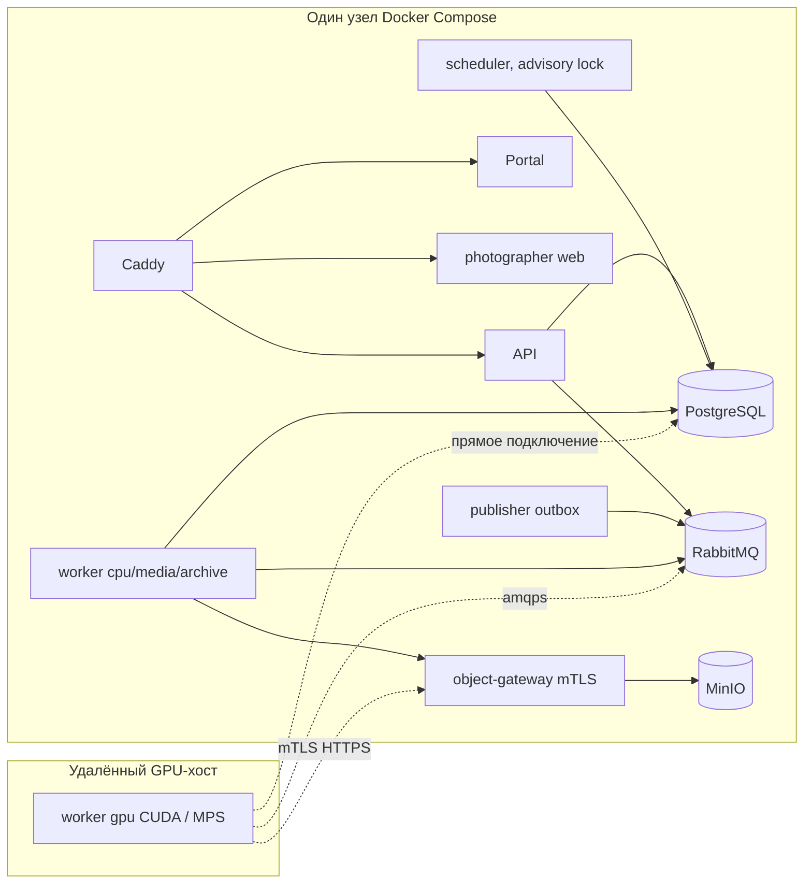

# 01. Архитектура

## 1. Карта системы (по факту кода)

| Компонент | Где | Технологии | Роль |
|---|---|---|---|
| API / scheduler / publisher / maintenance / gateway | `backend/cmd/photo` (роль задаётся `PHOTO_ROLE`), `backend/internal/*` (≈68 пакетов) | Go, PostgreSQL (pgx, sqlc), RabbitMQ, MinIO/S3 | Control plane: аутентификация, tenant, проекты, коллекции, run/apply workflow, квоты, outbox, выдача клиентам |
| Object gateway | `backend/internal/gateway` | Go, mTLS | Единственная точка доступа worker к артефактам (`/internal/v1/tasks/{id}/objects|outputs`) |
| Worker | `workers/photo_worker` | Python 3.11, pika, psycopg, onnxruntime/torch, pyvips | Исполнение операций (cpu/media/archive/gpu: CUDA или MPS) |
| Приложение фотографа | `apps/photographer` | Expo / React Native Paper / react-native-web | Основной инструмент (web — целевая платформа MVP) |
| Портал клиента | `apps/portal` | Next.js 16 (standalone), React 19 | Просмотр, выбор, скачивание, гостевая загрузка |
| Общие контракты | `packages/contracts`, `packages/api-client`, `backend/db` | JSON/OpenAPI, генераторы | Единый источник типов |
| Studio agent / local-editor | `apps/studio-agent`, `apps/local-editor` | Python | Вне MVP |

Размеры (подсчёт по исходникам): Go — 3 969 файлов, ≈377 тыс. строк (без тестов; часть — сгенерированный sqlc); Python worker — 1 238 файлов, ≈110 тыс. строк; приложение фотографа — 585 production-файлов TS/TSX; портал — ≈1,2 тыс. строк; миграции — 2 626 файлов (нумерация до `02659`).

## 2. Текущая топология и целевая

**Заявлено заказчиком:** всё, кроме worker, — на небольших серверах в кластере; worker — на GPU-кластере (CUDA или Apple Silicon); взаимодействие по VPN, полностью асинхронное.

**Фактически в репозитории:**

Файлы: `deploy/compose.yaml` (топология, профили `cuda`, `mail`, `v2`), `deploy/framevela/provision.py` (первичная установка), `deploy/rtx_installation.py` и `deploy/compose.rtx-worker.yaml` (удалённый RTX-воркер).

Расхождения с целью:

* Нет описания и конфигов **кластера**: один экземпляр PostgreSQL/RabbitMQ/MinIO (`minio server /data`), нет репликации/HA, нет оркестратора (k8s/swarm/nomad) — grep по `deploy/`, `docs/implementation-v2/18-*.md`, `19-*.md` не находит ни VPN/WireGuard, ни k8s.
* Нет описания **VPN-схемы**: адресов, MTU, маршрутизации, политик доступа от GPU-хоста к PostgreSQL/RabbitMQ/gateway, сертификатной цепочки для удалённых воркеров.
* GPU-воркер ходит в **PostgreSQL напрямую** (см. §3).

## 3. Каналы взаимодействия worker ↔ control plane

| Канал | Код | Кто инициирует | Что передаёт | Оценка для VPN |
|---|---|---|---|---|
| Диспетчеризация задач | `workers/photo_worker/runtime/transport.py` (`Transport.consume`), `backend/internal/queue` | Worker (pull, `prefetch=1`), очередь на воркера `q.worker.<id>.<class>` | Команда задачи (≤64 КиБ; archive ≤1 МиБ) | **Хорошо:** egress-only, ack после фиксации результата, quorum-очереди, TLS обязателен в production |
| SQL control plane | `runtime/database.py` (`TaskDatabase`) | Worker | `claim_task`, `heartbeat_task`, `commit_task_success/failure`, ≈100 функций допуска/квалификации (`photo.admit_*`, `photo.v27_*`, …) | **Плохо:** worker держит DB-учётку; новое TCP+TLS+auth соединение на *каждый* вызов; таймауты 5 с |
| Артефакты | `runtime/gateway.py` (`Gateway.open_stream`, `Gateway.upload`) | Worker | Чтение входов, запись выходов (до 20 ГиБ) | **Средне:** mTLS и проверка SHA-256 — отлично; одно HTTP-соединение на файл, нет докачки |
| Heartbeat ёмкости | `runtime/capacity.py` (`CapacityReporter.run`) | Worker, каждые 10 с | Реестр/ресурсы узла | **Плохо:** первая же ошибка → `stop.set()` + `abort()` → воркер останавливается |

Вывод: диспетчеризация асинхронна и устойчива; **фиксация результата, продление lease и учёт ёмкости — синхронные вызовы в БД по «хрупкому» каналу**. Для «полностью асинхронного» взаимодействия по VPN нужно заменить прямой SQL на версионированный control-plane API (см. [MVP/01](MVP/01-worker-and-vpn.md), пункты W-1…W-6).

## 4. Сильные архитектурные решения (сохранить)

1. **Lease + fencing token** на каждую попытку задачи (`claim_task` → `heartbeat_task` → `commit_task_*` с `fence`); потерянная lease → выход без записи (`executor.py`, `ExecutionContext`).
2. **Transactional outbox → RabbitMQ**, quorum-очереди, `x-delivery-limit`, dead-letter (`backend/internal/queue/topology.go`, `publisher.go`, `deadletter.go`).
3. **Идемпотентность HTTP-мутаций** (`Idempotency-Key` на сервере и в клиентах), восстановление повторов после обрыва.
4. **Изоляция tenant** на уровне SQL-ролей, `SECURITY DEFINER` функций с владельцем `photo_fn_owner` и RLS; worker проверяет роль при подключении (`application_role.py`, `TaskDatabase._connect`).
5. **mTLS worker→gateway**, проверка SHA-256 артефактов в обе стороны, бюджеты скачивания/выгрузки.
6. **Capacity/admission** как данные: бюджеты RAM/VRAM/scratch на задачу, квоты, DRR-планировщик (`docs/implementation-v2/18-capacity-operations.md`).
7. **Fail closed** для неквалифицированных моделей/backend (`_model_backend_enabled`, `_select_cuda_only_backend`): операция не объявляется доступной.
8. **Генерация контрактов** (`scripts/generate-*.py`, `make contracts-check`) — защита от дрейфа типов.

## 5. Архитектурные проблемы

| № | Проблема | Серьёзность для MVP | Где | Рекомендация |
|---|---|---|---|---|
| A1 | Worker связан с PostgreSQL через ≈100 SQL-функций; GPU-кластер получает DB-учётки и прямой доступ к БД по VPN | **Высокая** | `runtime/database.py` (1 164 строки, класс `TaskDatabase`) | Control-plane API для worker (mTLS HTTPS): `claim`, `heartbeat`, `commit`, `admit/*`; SQL-функции оставить как реализацию на стороне сервера |
| A2 | Хрупкость к сетевым сбоям: одна ошибка heartbeat = потеря задачи; результат не буферизуется; нет докачки | **Высокая** | `executor.py: Executor.process`, `capacity.py: CapacityReporter.run`, `gateway.py` | Допуск k пропусков в окне lease, спул результата и повтор commit, Range/multipart, ключ идемпотентности по SHA |
| A3 | Единственный узел и единственные экземпляры PG/MQ/MinIO; scheduler — синглтон (advisory lock) | Средняя (MVP допускает), **Высокая** для заявленного кластера | `deploy/compose.yaml`; `docs/implementation-v2/18-capacity-operations.md` («tenant sharding и active-active не входят в v2») | Определить минимальный HA-профиль: PG-реплика + PITR, RabbitMQ 3-узловой quorum, MinIO distributed/внешний S3 |
| A4 | Для запуска обработки нужна «церемония»: квалификация, DBA-строки политик, operator-команды, замороженные lock-файлы | Средняя | `deploy/README.md`, `deploy/*.sql`, `backend/cmd/photo/*_installation.go` (60+ файлов) | MVP-профиль «admit by lock file»: один сид-скрипт и один проверочный `doctor` вместо ручных SQL |
| A5 | Миграционная цепочка непомерна: 2 626 файлов, ряд файлов 80–170 КБ, 27 МБ сгенерированный SQL упомянут в плане релиза (R6) | Средняя | `backend/db/migrations`, `docs/implementation-v2/mvp-web-release-plan-2026-10-20.md` | Сделать «baseline snapshot» (squash до фиксированной версии) для новой установки; цепочку оставить для апгрейда |
| A6 | Клиент хранит ≈55 независимых журналов попыток (`*-attempt-store.ts`) и сбрасывает их поимённо при выходе | Средняя | `apps/photographer/src/auth-context.tsx` (строка 74, один вызов с ≈55 `clear*`) | Единый `MutationJournal` с типом операции вместо 55 копий |
| A7 | Развёртывание frontend привязано к игнорируемому `work/` и конкретному Cloudflare-аккаунту | Средняя | `deploy/framevela/photographer/wrangler.jsonc` (`assets.directory` → `work/…`), `deploy/framevela/portal/wrangler.jsonc` | Воспроизводимая сборка из репозитория, параметры окружения вне VCS |
| A8 | Наблюдаемость отсутствует: нет `/metrics`, трассировки, дашбордов (кроме Cloudflare observability для portal) | Средняя | `backend/internal/httpapi`, `deploy/` | Минимум: Prometheus-метрики API/очереди/worker + алерты (глубина очереди, возраст outbox, lease-expiry) |
| A9 | Нет ограничения частоты запросов, кроме выдачи OTP | Средняя | `backend/internal/auth/service.go:140-158` (`photo.auth_rate_limits`) | Лимиты на `portal/sessions`, `download-intent`, `uploads`, регистрацию на уровне Caddy или middleware |

## 6. Соответствие явным требованиям задания

| Требование | Статус | Основание |
|---|---|---|
| Всё кроме worker — на небольших серверах кластера | **Не выполнено / не описано** | Одноузловой compose, нет HA, нет оркестратора |
| Worker на кластере GPU (CUDA или Apple Silicon) | **Частично** | Профиль `cuda` и RTX-установка есть (`deploy/rtx_installation.py`); MPS — «native-host», без пакета развёртывания; на MPS не устанавливаются семантические провайдеры, learning и restoration (glare/reflection); region — только при MPS-реализации (`runtime/service.py: _select_cuda_only_backend`, `_select_restoration_backend`) |
| Полностью асинхронное взаимодействие по VPN | **Частично** | Dispatch асинхронный (AMQP pull). Commit/heartbeat/ёмкость — синхронный SQL, без устойчивости к разрыву |
| В MVP: photographer и portal | **Да, с оговорками** | Оба собираются и проходят typecheck; e2e и измерения UI (контраст, размер текста) не выполнены |
