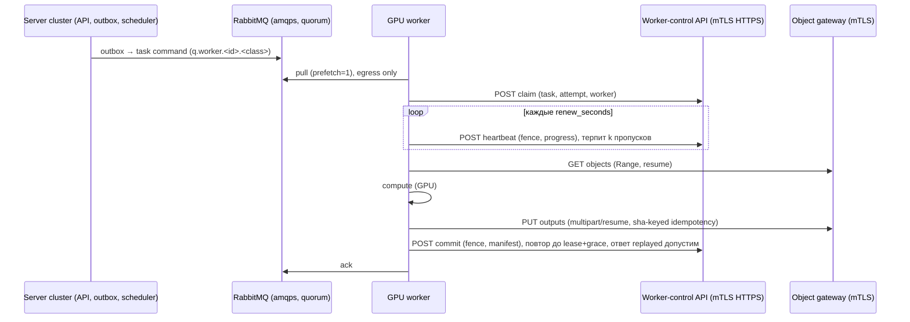

# MVP-01. Worker и взаимодействие по VPN (асинхронно)

Цель: GPU-воркеры (CUDA / Apple Silicon) живут в отдельной сети, соединённой с серверным кластером по VPN. **Любой разрыв канала не должен приводить к потере выполненной работы**; воркер сам инициирует все соединения (egress-only), а результат доставляется «at-least-once + идемпотентно».

Связанные замечания: A1, A2, D-01…D-08 из [../05-defects-and-gaps.md](../05-defects-and-gaps.md).

## 0. Целевая схема

Принципы:

1. **Состояние задач — только через control-plane API**, не через прямой SQL (убрать `DATABASE_URL` из окружения GPU-воркера).
2. **Fencing сохраняется:** любой запрос содержит `(task_id, attempt, fence, worker_id)`; сервер решает `claimed/replayed/stale/cancelled`.
3. **Терпимость к пропускам:** потеря связи на время < оставшегося lease не отменяет работу; запись в хранилище прекращается только когда локальная lease истекла (`ExecutionContext.check_active`).
4. **Идемпотентные повторы везде:** commit и загрузка артефактов повторяются с тем же ключом.

## 1. Приоритеты

| ID | Приоритет | Работа | Трудоёмкость |
|---|---|---|---|
| W-1 | P0 | Терпимость heartbeat задачи | S |
| W-2 | P0 | Терпимость heartbeat ёмкости | S |
| W-3 | P0 | Повтор commit + спул результата | M |
| W-6 | P0 | TLS у RabbitMQ и VPN-готовые параметры соединений | S–M |
| W-4 | P1 | Пул соединений PostgreSQL, keepalive, `verify-full` (временный мост до W-7) | S |
| W-5 | P1 | Докачка артефактов, детерминированный ключ идемпотентности | M |
| W-7 | P1 | Control-plane API для worker вместо SQL | L |
| W-8 | P1 | Идентичность воркера и отзыв сертификата | M |
| W-11 | P1 | Chaos-тесты сети | M |
| W-12 | P1 | Контроль расхождения часов, сроки lease в относительных величинах | S |
| W-9 | P2 | Рефакторинг `build_worker` | M |
| W-10 | P2 | Пакет развёртывания для Apple Silicon | M |

## 2. Детали

### W-1. Терпимость heartbeat задачи (P0)

* **Где:** `workers/photo_worker/runtime/executor.py` → `Executor.process` → вложенная функция `heartbeat()` (строки 180–192).
* **Сейчас:** любое исключение из `self.database.heartbeat(...)` → `ctx._lost.set(); return` (строка 192) — поток heartbeat завершается навсегда.
* **Изменить:**
  1. Внутри `heartbeat()` ловить транспортные ошибки (`psycopg.OperationalError`, `psycopg.InterfaceError`, `TimeoutError`, `OSError`, `GatewayError`/control-client ошибки с `retryable=True`) отдельно от «серверных отказов» (`beat.accepted is not True`, `cancel_requested`).
  2. При транспортной ошибке — повтор с backoff (0,5 → 1 → 2 с, затем каждые 2 с) **пока** `monotonic() < ctx._lease_until - guard` (guard ≈ 2 с); `ctx._lost` ставить только по истечении локальной lease или по ответу сервера.
  3. Добавить в `ExecutionContext` счётчик/метку `heartbeat_degraded` (для метрик и `emit_failure_metadata`).
  4. Условие остановки не менять: `ExecutionContext.accept_heartbeat` уже обнуляет lease при `accepted is not True`.
* **Тесты:** `workers/tests/test_heartbeat_tolerance.py` (новый): (a) БД недоступна 25 с при lease 60 с → задача завершается успешно; (b) недоступна 70 с → `lease_lost`, запись не происходит; (c) сервер вернул `accepted=False` → немедленный выход.
* **Осторожно:** `workers/tests/test_heartbeat_chain_source_pins.py` пинит тексты SQL-обёрток и срезы `database.py` (`task_result_fence_ready` … `removal_preview_runtime_ready`); не менять эти функции в рамках W-1.

### W-2. Терпимость heartbeat ёмкости (P0)

* **Где:** `runtime/capacity.py` → `CapacityReporter.run` (строки 65–79); потребитель — `runtime/service.py` → `_run_built_worker` (`reporter.failed.is_set()` в конце, `reports = Thread(target=reporter.run…)`).
* **Сейчас:** первая ошибка → `failed.set(); stop.set(); self.abort()` → останавливаются приём задач и текущая работа.
* **Изменить:** разделить два случая:
  * **Транспортная ошибка** — считать подряд идущие ошибки; при достижении `N = ceil(offline_seconds / heartbeat_seconds)` (по `CapacityPolicy`: 30/10 → 3) **перестать брать новые задачи** (флаг паузы у `Transport`), но *не* вызывать `abort()` для активной задачи — её судьбу решает lease (W-1). Продолжать попытки; при успехе снять паузу.
  * **Явный отказ** (`report(...)` вернул не `True` → `RuntimeError('Worker registration rejected')`) или сигнал о превышении бюджета Metal/CUDA — прежнее поведение (fail closed).
* **Изменить также:** `Transport` (`runtime/transport.py`) — добавить `pause_event`, проверяемый перед `basic_consume`/в цикле `consume`; `_run_built_worker` — передавать его в `CapacityReporter`.
* **Тесты:** `workers/tests/test_capacity_reporter_tolerance.py`; существующие тесты MPS-бюджета (`test_metal_budget_lifecycle.py`) должны остаться зелёными.

### W-3. Повтор commit и спул результата (P0)

* **Где:** `executor.py` → `Executor.process`, блок после `metrics = TaskMetrics(...)` (строки ≈250–265): `self.database.commit_failure(...)`, `self.database.commit_success(...)`.
* **Факт:** серверные функции `photo.commit_task_success/failure` уже возвращают `committed | replayed | stale` и проверяют `fence` — повтор безопасен (см. проверку `if outcome not in ('committed','replayed','stale')`).
* **Изменить:**
  1. Ввести `commit_with_retry(fn, ctx, *, grace=30)` в `runtime/executor.py` (или `runtime/commit.py`): повторять при транспортных ошибках с backoff до `lease_until + grace` (по часам сервера, пересчитанным в monotonic), при `stale` — выход без ошибки.
  2. **Спул результата (P1-часть):** перед первой попыткой commit записать в `scratch/<task_id>.<attempt>.commit.json` (`lease`, `payload`/`failure`, `metrics`), чтобы после рестарта воркера процесс мог доставить результат; на старте `runtime/service.py: _run_built_worker` просматривать спул до приёма новых задач. Удалять файл только после `committed/replayed/stale`.
  3. Не делать `raise RuntimeError('COMMIT_CONFLICT')` на транспортных ошибках: оставить исключение только для `outcome == 'conflict'`.
* **Тесты:** `workers/tests/test_commit_retry.py`: обрыв на 1-й и 2-й попытке → `committed`; обрыв до истечения grace → сообщение не ack, спул остаётся; рестарт доставляет результат.
* **Метрика/лог:** счётчик `commit_retries`, `commit_spooled` (через `emit_failure_metadata`/логирование).

### W-4. Пул соединений и безопасный TLS (P1, мост до W-7)

* **Где:** `runtime/database.py` → `TaskDatabase.__init__`, `_connect` (54–62), `_query` (365–374).
* **Изменить:**
  1. Использовать `psycopg_pool.ConnectionPool(min_size=1, max_size=2)` (добавить `psycopg[pool]` в `workers/pyproject.toml`, сейчас там только `psycopg[binary]`) с `check=ConnectionPool.check_connection`; сохранить `options='-c role=photo_worker -c statement_timeout=… -c lock_timeout=…'` и вызов `_require_role` при создании соединения (`configure=`).
  2. Параметры соединения: `keepalives=1, keepalives_idle=15, keepalives_interval=5, keepalives_count=3, tcp_user_timeout=15000`; `connect_timeout` и `statement_timeout` вынести в `WORKER_DB_CONNECT_TIMEOUT` / `WORKER_DB_STATEMENT_TIMEOUT_MS` (по умолчанию 10 с / 15 с; для `commit_*` — 30 с).
  3. Повтор в `_query` расширить на `psycopg.OperationalError` **только** для идемпотентных вызовов: `claim`, `heartbeat`, `commit_*`, все `admit_*`/`*_ready` (чистые проверки). Список передавать параметром `retry_transport=True`.
  4. DSN в развёртывании: `sslmode=verify-full&sslrootcert=/run/photo/tls/ca.crt` (CA уже выпускается `provision.py`), `deploy/framevela/provision.py:51`.
* **Осторожно:** `test_heartbeat_chain_source_pins.py` и ряд `test_*_installation.py` подменяют `database._query`; сигнатуру `_query(query, params)` сохранить.

### W-5. Докачка артефактов и ключи идемпотентности (P1)

* **Где (клиент):** `runtime/gateway.py` → `Gateway.open_stream` (141–168), `Gateway.upload` (178–250), строка 202 (`'Idempotency-Key': str(uuid4())`); `runtime/materialize.py` → `materialize_gateway`.
* **Где (сервер):** `backend/internal/gateway/download.go` (уже есть `boundedRange`, `maxRangeBytes = 16 MiB`, `OpenRange`), `upload.go`, `output_repository.go`.
* **Скачивание:** реализовать чтение по `Range` блоками (до 16 MiB) с повтором блока при ошибке; частичный файл в scratch, SHA-256 пересчитывать по уже записанному префиксу при возобновлении. Заголовки проверки (`X-Photo-SHA256`, `X-Photo-Artifact-ID`) сохранить.
* **Выгрузка:** (а) минимум — заменить `uuid4()` на детерминированный ключ `sha256(task_id | attempt | role | file_sha256)`, чтобы повтор PUT распознавался сервером как тот же; (б) целевой вариант — многочастная выгрузка: `POST …/outputs/{role}/uploads` → `PUT part N` (повторяемые) → `POST …/complete` с итоговым SHA; сервер использует S3 multipart. Лимит `WORKER_MAX_UPLOAD_BYTES` сохранить.
* **Тесты:** `workers/tests/test_gateway_resume.py` (обрыв посередине скачивания/выгрузки), `backend/internal/gateway/*_test.go` (Range, повторный PUT с тем же ключом → тот же результат; другой SHA с тем же ключом → отказ).

### W-6. TLS у RabbitMQ и параметры соединений (P0)

* **Где:** `deploy/compose.yaml` (сервис `rabbitmq`, строки 76–91), `deploy/framevela/provision.py:52`, `deploy/env/production.env.example:18`, `workers/photo_worker/runtime/transport.py` (`Transport.consume`, 54–70).
* **Изменить:**
  1. Добавить `deploy/rabbitmq/rabbitmq.conf` (`listeners.ssl.default = 5671`, `ssl_options.cacertfile/certfile/keyfile`, `ssl_options.verify = verify_peer`, `ssl_options.fail_if_no_peer_cert = true`, `listeners.tcp = none`), смонтировать секреты из `${PHOTO_SECRETS_DIR}/rabbitmq/`.
  2. `provision.py`: выпускать сертификат `rabbitmq` (SAN) тем же CA, формировать `AMQP_URL=amqps://…:5671/photo`.
  3. `Transport.consume`: `socket_timeout` 5 → 10–15 с, `stack_timeout` 10 → 20 с; добавить `tcp_options={'TCP_KEEPIDLE':15,'TCP_KEEPINTVL':5,'TCP_KEEPCNT':3}`; передавать SSL-контекст с CA и клиентским сертификатом воркера (`pika.SSLOptions`).
  4. Права RabbitMQ: отдельный пользователь на воркер с доступом только к `q.worker.<id>.*` (topic permissions).
* **Проверка:** `docker compose config`, интеграционный тест подключения по `amqps` с неверным/верным сертификатом.

### W-7. Control-plane API для worker (P1, целевая архитектура)

* **Новый серверный код:**
  * пакет `backend/internal/workerctl` (сервис + HTTP-обработчики);
  * маршруты в роли `object-gateway` (`backend/internal/gateway/http.go`) либо новая роль `worker-control` в `backend/cmd/photo/main.go` (`PHOTO_ROLE`);
  * эндпоинты (mTLS, JSON, canonical bytes): `POST /internal/v1/worker/claim`, `POST /internal/v1/tasks/{id}/heartbeat`, `POST /internal/v1/tasks/{id}/commit`, `POST /internal/v1/worker/capacity`, `POST /internal/v1/tasks/{id}/admit/{operation}`;
  * реализация вызывает существующие SQL-функции (`photo.claim_task`, `heartbeat_task`, `commit_task_success/failure`, `admit_*`), т.е. **миграции не меняются**;
  * авторизация: CN/SAN сертификата → `worker_id` (см. W-8), проверка принадлежности задачи воркеру.
* **Клиент (Python):** `runtime/control.py` с `Protocol TaskControl` (методы `claim/heartbeat/commit_success/commit_failure/report_capacity/admit(...)`); `TaskDatabase` остаётся как реализация `sql`, новая — `HttpTaskControl` (`http.client`/`httpx`, пул keep-alive, таймауты 10 с, повторы по W-1/W-3). Выбор — `WORKER_CONTROL_MODE=sql|http` в `WorkerConfig.from_env` (`runtime/service.py:119`).
* **Миграция по шагам:** (1) Protocol + адаптер `sql` (без изменения поведения); (2) `claim/heartbeat/commit/capacity` по HTTP; (3) 100 `admit_*`/`*_ready` — одной generic-точкой `admit/{operation}` с таблицей соответствия, сгенерированной скриптом из `database.py` (`scripts/generate-worker-control.py`); (4) удалить `DATABASE_URL` из `x-worker-env` (`deploy/compose.yaml:29`) и GPU-профилей.
* **Тесты:** контрактные (JSON-схемы в `packages/contracts`), `backend/internal/workerctl/*_test.go` (повтор, stale fence, cancel), e2e с воркером в режиме `http`.

### W-8. Идентичность воркера и отзыв (P1)

* **Где:** `deploy/framevela/provision.py` (выпуск `worker.crt`), `deploy/compose.yaml:273,282,291,303` (константные `PHOTO_WORKER_ID`), `backend/internal/gateway/authorization.go`, SQL-регистрация (`deploy/provision-*-worker.sql`, `activate-*.sql`).
* **Изменить:** сертификат на каждый хост с `CN=<worker_id>` и `extendedKeyUsage=clientAuth`; `PHOTO_WORKER_ID` генерировать при установке; на gateway/worker-control сопоставлять CN ↔ зарегистрированный `worker_id`; список отзыва (новая таблица реестра сертификатов — имя на усмотрение разработчика — или CRL-файл с горячей перезагрузкой); команда `photo-worker register --print-sql`/API вместо ручных `provision-*.sql`.

### W-9. Рефакторинг `build_worker` (P2)

* **Где:** `runtime/service.py:343–852` (`build_worker`), `853` (`run_worker` — дублирует сигнатуру).
* **Изменить:** объект `Installations` (dataclass) вместо ≈40 kwargs; таблица совместимости `COMPAT[(resource_class, backend)] -> допустимые установки`; общая функция `_require(installation, resource_class, backend, name)` вместо ≈25 ручных `if … raise WorkerConfigurationError`.
* **Тесты:** существующие `workers/tests/test_*_installation.py`, `test_executor_installation_boundary.py`, `test_service_lazy_imports.py` — должны проходить без правок поведения.

### W-10. Apple Silicon (P2)

* **Новое:** `deploy/mac-worker/` — `com.photoeditor.worker.plist` (launchd, KeepAlive), `install.sh` (venv через `uv sync --extra ml --extra media`, каталог моделей и lock, scratch на SSD, `PHOTO_CAPACITY_POLICY` на базе `configs/capacity-metal-verification.json`), `worker.env.example`, `photo-worker doctor` как healthcheck; инструкция по VPN-клиенту (WireGuard) и сертификатам.
* **Документация:** автоматически генерируемая матрица «операция × backend (cpu/cuda/mps)» из `models/backend_support` и `runtime/service.py` (`_select_cuda_only_backend`, `_select_restoration_backend`), чтобы UI/планировщик знали, какие операции доступны на Mac.

### W-11. Chaos-тесты сети (P1)

* **Новое:** `tests/integration/test_worker_network_faults.py` (+ compose-профиль `fault` с toxiproxy или `tc netem`). Сценарии: потеря связи 5/20/70 с во время вычисления; потеря во время загрузки артефакта; потеря на commit; разрыв AMQP при активной задаче; рестарт воркера со спулом; задержка 300 мс + 2 % потерь на всех каналах. Критерий: ни одной потерянной и ни одной задублированной записи результата (проверка по `photo.task_results`, outbox, объектам).

### W-12. Часы и сроки lease (P1, S)

* **Проблема:** `ExecutionContext.__init__` (`runtime/executor.py:59-60`) переводит `lease.deadline/lease.until` (время БД) в локальное монотонное время через `datetime.now(timezone.utc)` воркера. Рассинхронизация часов GPU-хоста с сервером (типично для удалённых/Mac-узлов) сокращает или удлиняет локальное «право писать» (комментарий в коде это признаёт).
* **Изменить:**
  1. `claim_task`/`heartbeat_task` (и control-API, W-7) возвращают дополнительно `server_now` либо относительные `lease_ttl_seconds`/`deadline_ttl_seconds`; воркер считает `monotonic() + ttl` без обращения к настенным часам. Если менять SQL-функции нежелательно — как минимум:
  2. При старте (`runtime/service.py: _run_built_worker`, рядом с `database.ping()`) сравнить `SELECT now()` с локальными часами; при расхождении > 2 с — отказ запуска с понятным кодом `CLOCK_SKEW`; периодически (раз в минуту) повторять и логировать.
  3. В `deploy/` — требование `chrony`/NTP на всех хостах (Linux: systemd-timesyncd/chrony; macOS: `sntp`/системная синхронизация), пункт в `photo-worker doctor` (`workers/photo_worker/cli.py`).
* **Тесты:** `workers/tests/test_clock_skew_guard.py`.
