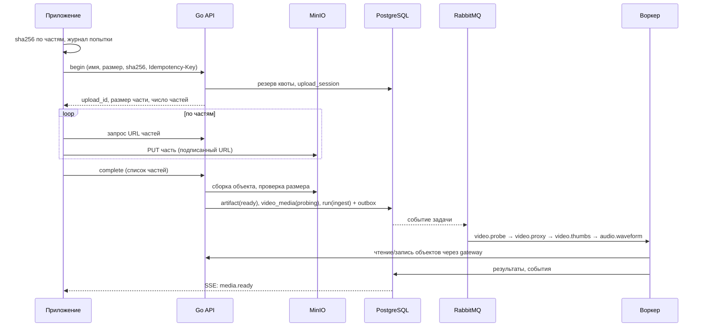
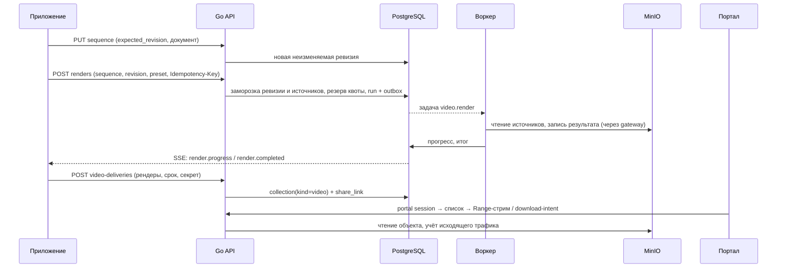

# 02. Архитектура

Статус: спроектировано, не реализовано (2026-10-22). Начало: [README](README.md). Принцип: **не изобретать новый тракт**, а повторить проверенные в фото-системе механизмы — загрузку с журналом попыток, workflow/runs/tasks с outbox и lease, gateway для воркеров, резервы квот, публикацию через коллекции и портал.

## 1. Компоненты

| Компонент | Роль для видео | Основа в репозитории |
|---|---|---|
| `apps/photographer` | экраны загрузки, медиатеки, детекции, монтажа, цвета, музыки, рендера, выдачи, квот | [`app/`](../../apps/photographer/app), [`screens/`](../../apps/photographer/screens), [`src/`](../../apps/photographer/src) |
| `packages/api-client` | клиент API: загрузка, документ монтажа, типы контрактов | [`src/upload.ts`](../../packages/api-client/src/upload.ts), [`src/sse.ts`](../../packages/api-client/src/sse.ts) |
| `backend` (Go) | авторизация, учёт квот, автоматы состояний, постановка заданий, подписи, SSE | [`backend/internal`](../../backend/internal), [`httpapi`](../../backend/internal/httpapi) |
| PostgreSQL | метаданные, ревизии монтажа, резервы квот, outbox | [`backend/db/migrations`](../../backend/db/migrations) |
| RabbitMQ | доставка задач воркерам через outbox | [`backend/internal/queue`](../../backend/internal/queue) |
| gateway | единственный путь воркера к объектам (mTLS, lease, fence) | [`backend/internal/gateway`](../../backend/internal/gateway) |
| MinIO | оригиналы, производные, рендеры, отчёты | [`backend/internal/objectstore`](../../backend/internal/objectstore) |
| `workers/photo_worker` | ffmpeg/ffprobe, модели детекции, цвет, звук, рендер | [`operations/`](../../workers/photo_worker/operations), [`models/`](../../workers/photo_worker/models), [`runtime/`](../../workers/photo_worker/runtime) |
| `apps/portal` | клиентский просмотр и скачивание | [`apps/portal/src`](../../apps/portal/src) |

## 2. Последовательности

### 2.1 Загрузка и ingest

### 2.2 Монтаж → рендер → выдача

## 3. Карта «как сделано сейчас → как делаем для видео»

| Задача видео | Существующий образец | Что повторяем | Что меняется |
|---|---|---|---|
| Возобновляемая загрузка большого файла | Архивы interchange: [`interchange-archive-screen.tsx`](../../apps/photographer/src/interchange-archive-screen.tsx), [`interchange-archive-controller.ts`](../../apps/photographer/src/interchange-archive-controller.ts), [`interchange-archive-attempt-store.ts`](../../apps/photographer/src/interchange-archive-attempt-store.ts); API `…/interchange-archive-uploads` (begin, attempt-status, parts, complete, status, abort) в [`owner-api.ts`](../../apps/photographer/src/owner-api.ts); бэкенд [`interchange_archive_upload.go`](../../backend/internal/httpapi/interchange_archive_upload.go), [`objectstore/multipart.go`](../../backend/internal/objectstore/multipart.go) | журнал попытки, идемпотентность, abort/reconcile, ограничение времени простоя | лимиты размера, размер части, пакетная очередь файлов, потоковый SHA-256 без загрузки файла в память |
| Постановка тяжёлой работы | Фото-операции: runs/tasks/outbox/lease; [`backend/internal/run`](../../backend/internal/run), [`workflow`](../../backend/internal/workflow), [`queue`](../../backend/internal/queue) | `Idempotency-Key`, outbox, lease/fence, отмена, повтор | новые виды run (`video_*`), новые операции |
| Реестр операций и выход воркера | [`operations.json`](../implementation-v2/contracts/operations.json), [`workers/photo_worker/operations`](../../workers/photo_worker/operations), [`contracts`](../../workers/photo_worker/contracts) | роль выхода, `max_output_bytes`, `max_output_count`, `timeout_seconds`, `role_policies` | новые роли выхода: `video`, `proxy`, `thumbs`, `waveform`, `cut_report`, `color_report`, `preview_frame` |
| Прогресс | SSE [`event_sse.go`](../../backend/internal/httpapi/event_sse.go), [`sse.ts`](../../packages/api-client/src/sse.ts), [`run-watch.ts`](../../apps/photographer/src/run-watch.ts), экран [`runs/[id].tsx`](../../apps/photographer/screens/runs/[id].tsx) | курсор событий, восстановление после обрыва | поля `stage`, `progress`, `eta_seconds` для долгих заданий |
| Версионируемый рецепт редактирования | Редактор: [`editor-store.ts`](../../apps/photographer/src/editor-store.ts), [`editor-draft-cache.ts`](../../apps/photographer/src/editor-draft-cache.ts), [`editor-save-edits-attempt.ts`](../../apps/photographer/src/editor-save-edits-attempt.ts), [`editor-draft-conflict.tsx`](../../apps/photographer/src/editor-draft-conflict.tsx) | CAS `expected_revision`, локальный черновик, диалог конфликта | документ — таймлайн; ревизии неизменяемы |
| Замороженные входы задания | [`19-runtime-protocol.md`](../implementation-v2/19-runtime-protocol.md): `InputClosureManifest`, `v2_task_inputs` | манифест замыкания вместо тысяч входов | список источников монтажа и их SHA-256 |
| Квота и резервы | `photo.quota_reservations`, `photo.tenant_usage`; миграции [02600](../../backend/db/migrations/02600_billing_quota_accounting.sql), [02601](../../backend/db/migrations/02601_billing_quota_functions.sql); загрузка резервирует место ([02641](../../backend/db/migrations/02641_user_project_upload_completion.sql)) | атомарный резерв до работы, освобождение остатка при завершении | новые `holder_type` (`video_upload`, `video_job`), категории учёта, оценка размера по профилю |
| Экран квот | [`screens/settings/quotas.tsx`](../../apps/photographer/screens/settings/quotas.tsx) | чтение через `OwnerAPI`, `ReadResourceState` | разбивка по видео-категориям |
| Выдача клиенту | Пакеты доставки: [`screens/deliveries`](../../apps/photographer/screens/deliveries), [`delivery.go`](../../backend/internal/httpapi/delivery.go), [`delivery_download_intent.go`](../../backend/internal/httpapi/delivery_download_intent.go); публикация [`collection-publication-contract.md`](../implementation-v2/contracts/collection-publication-contract.md); ссылки [`collection-access-links.tsx`](../../apps/photographer/src/collection-access-links.tsx) | публикация/снятие, секрет ссылки, отзыв, подписанные ссылки ≤ 60 с | тип контента `video`, плеер, Range-стрим |
| Портал клиента | [`apps/portal/src/app/(localized)/[locale]/s/[share_id]/page.tsx`](../../apps/portal/src/app/%28localized%29/[locale]/s/[share_id]/page.tsx), [`components/Portal.tsx`](../../apps/portal/src/components/Portal.tsx), [`lib/api.ts`](../../apps/portal/src/lib/api.ts) | обмен секрета на сессию, CSRF, восстановление скачивания | видеоплеер, карточки роликов |
| GPU/MLX-воркеры | [`compose.rtx-worker.yaml`](../../deploy/compose.rtx-worker.yaml), [`provision-rtx-worker.sql`](../../deploy/provision-rtx-worker.sql), [`runtime/cuda_budget.py`](../../workers/photo_worker/runtime/cuda_budget.py), [`runtime/metal_budget.py`](../../workers/photo_worker/runtime/metal_budget.py), [`models/backend_support.py`](../../workers/photo_worker/models/backend_support.py) | `PHOTO_WORKER_CLASS`, `PHOTO_WORKER_BACKEND`, политика ёмкости, квалификация модели по замку | бэкенд `mlx`; отдельный профиль «видео» (scratch, длительность, NVENC/VideoToolbox) |
| Тест Paper-политики | [`paper-ui-policy.test.ts`](../../apps/photographer/src/paper-ui-policy.test.ts) | запрет примитивов RN | специализированные поверхности (таймлайн, колёса, кривые) без запрещённых импортов |

## 4. Новые и изменяемые модули (предлагаемые пути)

Файлы ниже **не существуют**. Имена следуют соглашениям соседей; реальные имена уточняются при реализации.

### Backend (Go)

- `backend/internal/video/media` — медиа, автомат состояний, probe-сводка.
- `backend/internal/video/sequence` — ревизии монтажа, CAS, валидация документа, заморозка источников.
- `backend/internal/video/job` — виды заданий, допуск, резерв квоты, повтор, отмена.
- `backend/internal/video/quota` — оценка размера, категории учёта, расчёт остатка.
- `backend/internal/video/share` — публикация видео-коллекций, учёт трафика.
- `backend/internal/httpapi/video_*.go` — эндпоинты (см. [04](04-data-model-and-api.md)).
- `backend/internal/objectstore/video_upload.go` — multipart большого размера, проверка частей.
- `backend/db/migrations/02651…` — таблицы и функции (см. [04](04-data-model-and-api.md)).

### Worker (Python)

- `workers/photo_worker/operations/video/` — `probe.py`, `proxy.py`, `thumbs.py`, `detect_cuts.py`, `color_analyze.py`, `preview_frames.py`, `render.py`, `verify.py`.
- `workers/photo_worker/operations/audio/` — `waveform.py`, `analyze.py`.
- `workers/photo_worker/contracts/video.py` — контракты Params/Result.
- `workers/photo_worker/models/` — адаптеры детектора границ для `cuda` и `mlx`, запись в замок моделей.
- `workers/photo_worker/runtime/ffmpeg.py` — запуск ffmpeg в песочнице, парсинг `-progress`, ограничения.
- `workers/photo_worker/runtime/mlx_budget.py` — по образцу `metal_budget.py`.
- `workers/tests/` — тесты операций; golden-графы фильтров.

### Клиент

- `packages/api-client/src/video-upload.ts`, `video-timeline.ts`, `video-api.ts`.
- `apps/photographer/app/video/**` и `app/[locale]/video/**` — маршруты; `screens/video/**` — экраны; `src/video-*.ts(x)` — логика и компоненты.
- `apps/portal/src/components/VideoPortal.tsx`, `lib/video-api.ts` — просмотр у клиента.
- `locales/{en,ru,bg}/common.json` — ключи `video_*` (общий каталог переводов, см. [`locales`](../../locales)).

## 5. Инварианты, которые нельзя ослаблять

1. **Изоляция tenant** на каждом объекте, URL и задаче; чужой tenant не должен получать различимых ответов (404 вместо 403 там, где так сделано сейчас).
2. **Неизменяемость**: оригинал, ревизия монтажа, результат рендера — иммутабельны; изменение = новая запись.
3. **Идемпотентность** всех мутаций через `Idempotency-Key` и журнал попыток клиента; повтор не создаёт дублей и не списывает квоту дважды.
4. **Атомарность резерва**: квота резервируется до работы и освобождается/конвертируется в одной транзакции с изменением состояния.
5. **Воркер не ходит в MinIO напрямую**: только gateway с проверкой lease/fence и списком разрешённых объектов задачи.
6. **Нет молчаливой деградации**: нет модели/бэкенда → операция недоступна с причиной; откат на CPU возможен только как явно выбранный и квалифицированный режим.
7. **Подписанные ссылки** живут ≤ 60 с; продолжительный доступ даёт только повторная авторизация (см. [08](08-delivery-portal.md)).
8. **Capability-гейтинг**: UI показывает функцию по ответу сервера, а не по сборке клиента.
