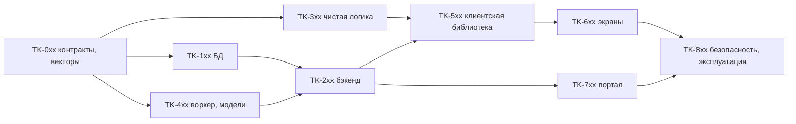

# 12. Метод декомпозиции и правила для исполнителя со слабой моделью

Статус: спроектировано, не реализовано (2026-10-22). Начало: [README](README.md). Документы 12–17 превращают ТЗ 01–11 в набор атомарных задач. Они ничего не меняют в решениях D-01…D-08; при расхождении побеждает документ 01–11, а расхождение — дефект документации (сообщить, не «исправлять молча»).

## 1. Зачем и для кого

Исполнитель — языковая модель с ограниченным контекстом и слабым выводом «по смыслу». Ей нельзя оставлять решений. Поэтому каждая задача:

1. Умещается в один файл или в одну связную пару «код + тест» (≲ 250 строк результата).
2. Содержит точные имена, сигнатуры, типы, коды ошибок и порядок шагов.
3. Указывает **файл-образец**, который нужно открыть и повторить по стилю.
4. Имеет **проверяемый тест** и **команду запуска**; для чистых функций — готовые числовые векторы из [`vectors/`](vectors/).
5. Перечисляет, чего делать **нельзя** (типичные ошибки).
6. Завершается конкретным артефактом-доказательством (раздел 7 документа [17](17-acceptance-and-dod.md)).

## 2. Уровни декомпозиции

| Уровень | Что это | Где описано | Пример |
|---|---|---|---|
| L0 | Требование ТЗ (`VID-*`) | документы 01–11 | `VID-T-04` команды обратимы |
| L1 | Пакет работ (`VID-WP-nn`) | [10](10-testing-acceptance-rollout.md) | `VID-WP-09` Монтаж |
| L2 | Задача `TK-nnn` | [15](15-task-cards.md) | `TK-301` реализовать `split_clip` |
| L3 | Функция / экран / структура / модель (`FN-nn`, `V-nn`, `DS-nn`, `ML-nn`) | [14](14-function-catalog.md), [13](13-data-structures.md), [03](03-photographer-screens.md), [06](06-workers-and-models.md) | `FN-T-04 split_clip` |
| L4 | Тест-кейс (`SP-01`, `CD-07`, `F1-03`, `T-…`) | [16](16-test-logic.md), [`vectors/`](vectors/) | `SP-04` → `SPLIT_NOT_ALIGNED` |

Трассировка: каждое `VID-*` ссылается ≥ 1 `TK`, каждый `TK` ссылается ≥ 1 тест-кейс (матрица — [17](17-acceptance-and-dod.md), раздел 6).

## 3. Нотация идентификаторов

| Префикс | Объект | Документ |
|---|---|---|
| `DS-nn` | структура данных (таблица, тип, контракт, перечисление) | 13 |
| `FN-<модуль>-nn` | функция | 14 |
| `TK-nnn` | задача | 15 |
| `V-nn` | экран | 03 |
| `ML-nn` | модель / алгоритм | 06, 14 |
| `TC-<область>-nn` | тест-кейс, не из векторов | 16 |
| `ACC-nn` | критерий приёмки (отличать от векторных кейсов `AC-01…AC-04` в `commands.json`) | 17 |
| `VID-SC-nn` | требование масштабирования и эксплуатации | 20 |
| `TC-SC-*`, `TC-LOAD-05…10` | тесты масштабирования | 20, 16 |
| `D-nn` | принятое проектное решение (D-01…D-08 — 01/02; D-09…D-16 — 20; D-17…D-23 — 22; D-24…D-36 — 23) | 01, 02, 20 |

Нумерация задач: `TK-0xx` подготовка и контракты; `1xx` БД; `2xx` бэкенд Go; `3xx` чистая логика клиента/воркера (время, команды, валидатор); `4xx` воркер и модели; `5xx` клиентская библиотека и хранилища; `6xx` экраны; `7xx` портал; `8xx` безопасность и эксплуатация.

## 4. Шаблон карточки задачи

Карточка в [15](15-task-cards.md) всегда содержит поля в этом порядке:

```
TK-nnn  <название>
Требования: VID-… ; Пакет: VID-WP-… ; Зависит от: TK-…
Создать/изменить: <путь> (новый|изменить)
Образец (открыть и повторить стиль): <путь существующего файла>
Вход/выход: <точная сигнатура или контракт; ссылка на DS/FN>
Алгоритм: 1. … 2. … (нумерованные шаги, без «и т.д.»)
Ошибки: <код> когда <условие>
Тесты: <файл теста>; кейсы: <ID>; векторы: <путь>
Команда проверки: <точная команда>
Готово, когда: <измеримые условия>
Не делать: <запреты>
```

## 5. Правила для исполнителя (обязательны)

### 5.1 До начала
1. Прочитать карточку целиком, затем файл-образец и документы, на которые ссылается карточка. Не читать «весь репозиторий».
2. Проверить, что все `Зависит от` выполнены (есть доказательство из раздела 7 документа 17). Если нет — остановиться и сообщить.
3. Проверить, что целевой файл не существует (для «новый»). Если существует — остановиться и сообщить, не перезаписывать.

### 5.2 Во время
4. **Один шаг — одна проверка.** После каждой функции запускать её тест (команда в карточке), а не копить код.
5. **Тесты пишутся первыми** для функций с векторами: сначала загрузчик вектора и красный тест, затем реализация.
6. **Не придумывать имена.** Имена полей, кодов ошибок, файлов, ролей и констант берутся дословно из DS/FN/карточки. Нужного имени нет — остановиться и спросить; не изобретать.
7. **Не менять тест, чтобы он прошёл.** Ожидаемые значения в `vectors/*.json` — спецификация. Расхождение результата с вектором — дефект реализации, пока человек не подтвердил обратное (в этом случае чинится документ + вектор + эталон, [16](16-test-logic.md), раздел 2).
8. **Не добавлять** зависимости, файлы, эндпоинты и поля, которых нет в карточке.
9. **Целые числа во времени.** Любая арифметика с тиками — целочисленная (`//` в Python, `Math.trunc`/целочисленное деление в TS, `/` на `int64` в Go). Запрещены `float` и `Math.round` для тиков.
10. **Ошибки — по коду.** Исключения/ошибки несут код из таблицы DS-24; сообщение для человека необязательно и не используется в тестах.
11. **Каждая мутация** (API, БД) принимает идемпотентный ключ и `expected_revision`, если карточка так говорит; нет — не добавлять сверх карточки.
12. **UI только Paper** (`react-native-paper`). Импорт `Text`, `Button`, `TextInput`, `Switch`, `Modal`, `ActivityIndicator`, `Pressable`, `Touchable*` из `react-native` запрещён; проверяет `paper-ui-policy.test.ts`.
13. **Строки интерфейса** — только через ключи `video_<экран>_<элемент>` в `locales/{en,ru,bg}/common.json`; одинаковый набор ключей во всех трёх.
14. **Секреты, пути и имена файлов** не попадают в логи, SSE и сообщения об ошибках.

### 5.3 После
15. Запустить **команду проверки** из карточки и приложить вывод (раздел 7 документа 17).
16. Запустить **общие проверки слоя** (`DoD` документа 17, раздел 3) на затронутом пакете.
17. Если команда не может быть запущена (нет окружения) — записать «не проверено: причина» и **не** отмечать задачу выполненной.
18. Не запускать `git push`; коммит — только если об этом просит человек. Сообщение коммита — по правилам репозитория.

### 5.4 Когда остановиться и спросить
Остановка обязательна, если: карточка противоречит файлу-образцу; нужный тест красный до изменений; векторы расходятся с карточкой; требуется изменить файл вне списка карточки; миграция с таким номером уже есть; тест нестабилен (проходит не всегда); в карточке есть слово «определить» без значения.

## 6. Порядок выполнения (граф зависимостей)



Внутри уровня задачи с «Зависит от: —» можно выполнять параллельно разными исполнителями, но общий стенд (БД, MinIO, RabbitMQ) один ([10](10-testing-acceptance-rollout.md), раздел 1).

## 7. Происхождение числовых векторов (важно)

Файлы в [`vectors/`](vectors/) созданы **одноразовой независимой эталонной реализацией** (`vectors/reference/ref_*.py`) по тексту ТЗ 05–07, а не взяты из рабочей системы. Это означает:

- они согласованы с ТЗ на момент 2026-10-22 и проверены повторным запуском ffmpeg для фикстур и графов ([`vectors/golden_render.md`](vectors/golden_render.md));
- эталонные скрипты **не входят в продуктовый код**, не запускаются в CI продукта и нужны только для пересчёта векторов при изменении ТЗ;
- детектор (`cuts.json`) проверяет **постобработку** по заданным вероятностям, а не качество модели; качество проверяется метриками F1 на фикстурах ([16](16-test-logic.md), раздел 6);
- допуски числовых сравнений указаны в [16](16-test-logic.md), раздел 3; без допуска сравнение точное.

Если реализация и вектор расходятся, а ТЗ допускает оба прочтения, исполнитель **останавливается** (п. 5.4).

## 8. Контекстный пакет карточки (окно 32 000 токенов)

Целевая модель — класса 35B с окном **32 000 токенов**; весь ТЗ (≈ 900 КБ, ≈ 380 000 токенов) и файл `editor.json` (≈ 390 КБ) в окно не входят. Поэтому исполнитель получает не документы, а **пакет карточки**, который собирает `tools/ctx.py`:

- `python3 tools/ctx.py TK-640` печатает карточку, разделы ТЗ и строки каталога функций, на которые она ссылается, и первые 2 случая каждого указанного раздела векторов (остальное — по требованию: `python3 tools/ctx.py --slice editor.json compose_at 5`);
- `python3 tools/ctx.py --check` оценивает все карточки (2,4 символа на токен, запас 4 800 токенов на образец и код) и завершается кодом 1, если пакет какой-либо карточки больше **18 000 токенов**, если ссылка карточки не находит раздел или функцию, либо если карточка составная (`TK-606`) и выдана исполнителю;
- составные карточки не выдаются: выдаются их части ([15](15-task-cards.md)).

Правила составителя карточек: ссылка на документ всегда с номером раздела (`[23](23-editor-playback-timeline.md) раздел 7`, `§7`, `п. 4.5`); не ссылаться на документ целиком; новый раздел длиннее ≈ 12 000 символов делить на подразделы; перед коммитом документов запускать `--check`. Состояние на 2026-10-23: 135 карточек, 0 сверх бюджета, самый тяжёлый пакет — TK-621 (≈ 8 200 токенов).
