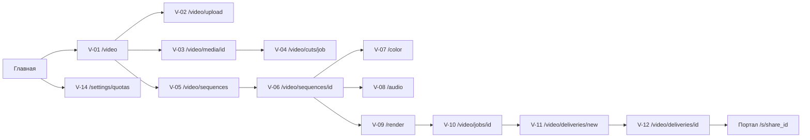

# 19. Пользовательские потоки и сценарии e2e

Статус: спроектировано, не реализовано (2026-10-22). Начало: [README](README.md). Варианты использования — [18](18-use-cases.md). Экраны — [03](03-photographer-screens.md), логика тестов — [16](16-test-logic.md), критерии — [17](17-acceptance-and-dod.md), коды ошибок — [13](13-data-structures.md) (DS-24).

## 1. Карта переходов

Экран V-13 (диалоги и баннеры состояний) отдельного маршрута не имеет; его элементы проверяются внутри потоков. Портал: P-01 вход/пароль, P-02 просмотр, P-03 «ссылка недоступна».

## 2. Соглашения для e2e

### 2.1. Идентификаторы элементов (testID)
Формат `video.<экран>.<элемент>`; в Paper-компонентах задаётся свойством `testID`, на web превращается в `data-testid`. Примеры: `video.upload.dropzone`, `video.upload.row.<n>.status`, `video.media.card.<id>`, `video.seq.timeline`, `video.seq.clip.<id>`, `video.seq.save-state`, `video.render.start`, `video.job.status`, `video.delivery.link`, `video.quota.used`, `portal.player`, `portal.download`. Тесты не ищут элементы по тексту (тексты локализуются) — только по `testID`, ролям доступности и `data-state`.
Статусы выставляются атрибутом `data-state` со значениями из DS-13…DS-17 (`queued`, `running`, `ready`, `failed`, …).

### 2.2. Ожидания
- Асинхронные задания: ждать `data-state` терминального значения опросом раз в 500 мс, максимум 120 с на CPU-воркере для фикстур; бездумные паузы запрещены.
- Каждое ожидание оканчивается сообщением, какое состояние ожидалось и какое получено.
- SSE: тест не зависит от SSE; при обрыве приложение переходит на опрос ([02](02-architecture.md)), что проверяется отдельно (F-35).

### 2.3. Проверки сквозного уровня
Каждый сценарий проверяет три слоя: **видимое** (UI), **API** (прямой запрос от имени пользователя), **состояние** (квоты, объекты MinIO, строки БД через тестовый эндпоинт/SQL-доступ стенда). Расхождение между слоями — провал.

### 2.4. Идемпотентность и очистка
Сценарии не зависят друг от друга порядком. Каждый создаёт свои сущности и в конце удаляет. Утечки (остаточные резервы, объекты без записи) проверяет финальный сценарий сверки E2E-29.

### 2.5. Приоритеты
P0 (смоук, на каждый коммит): E2E-01, 04, 07, 09, 15, 19, 24. P1 (регрессия, ночью): остальные кроме P2. P2 (релиз, долгие): E2E-02 с 16 ГиБ, 28, 30.

## 3. Потоки

Формат шага: **№ · Действие (экран) → Ожидаемо (UI · API · состояние)**.

### F-01. Загрузка видео (UC-01, UC-06)
Предусловия: TEN-A, вход `owner@a`, FX-VID `hard_cuts.mp4`.
1. Открыть `/video` (V-01) → заголовок, пустое состояние с кнопкой «Загрузить».
2. Нажать «Загрузить» → переход на `/video/upload` (V-02); зона `video.upload.dropzone`.
3. Выбрать файл → строка в очереди, `data-state=preparing`, показан размер; `POST` создания сессии вернул 201; в квоте появился резерв ≥ размера файла.
4. Передача частей → прогресс растёт монотонно; одновременно не более 3 частей (по сетевому журналу).
5. Завершение → `data-state=processing`; сессия закрыта (`completed`).
6. Ожидание `ready` → строка получает ссылку на карточку; в `/video` плитка с миниатюрой.
7. Проверка состояния → оригинал в MinIO побайтно равен исходному (sha256); создан proxy; `used` вырос на размер оригинала + производных; резервов нет.
Вариант «аудио»: тот же поток с `music.wav`; `kind=audio`, есть волна, proxy нет.

### F-02. Возобновление загрузки (UC-02)
Предусловия: FX-BIG 1 ГиБ.
1. Начать загрузку; при прогрессе 40–60 % закрыть вкладку (или перевести сеть в офлайн).
2. Открыть `/video/upload` снова → в очереди строка `data-state=paused` с прогрессом ≈ последнего.
3. Выбрать тот же файл по запросу приложения → передаются только недостающие части (сетевой журнал: не более частей «в полёте» повторно).
4. Дождаться `ready` → итог как F-01; sha256 совпадает.
Негатив: выбрать другой файл с тем же именем, но другим размером → отказ «файл не совпадает», сессия не затронута.

### F-03. Нет места (UC-03)
Предусловия: tenant `TEN-Q` с квотой меньше файла.
1. Выбрать файл → ошибка `VIDEO_QUOTA_EXCEEDED` до передачи данных; сообщение называет сколько нужно и сколько свободно; кнопка «Управление хранилищем» ведёт на V-14.
2. Проверка состояния → нет сессии, нет резерва, нет объектов; `used/reserved` прежние.

### F-04. Отклонение файла (UC-04)
1. Загрузить `random.bin` → после обработки `data-state=rejected`, код `VIDEO_UNSUPPORTED_FORMAT`, локализованное сообщение.
2. Загрузить `trunc.mp4` → `rejected`, код `VIDEO_CORRUPT`.
3. Состояние → объекты удалены, `used` вернулось к исходному, резервов нет, строка доступна для «Убрать из списка».

### F-05. Отмена загрузки (UC-05)
1. Начать загрузку FX-BIG, при ~20 % нажать «Отменить» → диалог подтверждения.
2. Подтвердить → `data-state=aborted` ≤ 5 с.
3. Состояние → части удалены из MinIO, резерв закрыт, медиа не создано.

### F-06. Медиатека (UC-08)
1. Пустой проект → пустое состояние.
2. Создать ≥ 25 медиа (через API) → первая страница ≤ 24 плиток, подгрузка при прокрутке без повторов; поиск и фильтр по `kind`, `status`.
3. Войти `viewer@a` → кнопок «Загрузить», «Удалить» нет (или `disabled` с подсказкой).

### F-07. Карточка исходника (UC-09)
1. Открыть плитку → `/video/media/[id]` (V-03).
2. Воспроизвести proxy → время идёт, звук есть (для видео с аудио); запросы диапазонов получают `307` на подписанную ссылку, байты идут с хранилища, не через Go (`ACC-55`).
3. Раскадровка и волна загружены; таблица probe: кодек, разрешение, fps, длительность в секундах и тиках совпадают с эталоном фикстуры.
4. Предупреждения (переменный fps, нет аудио) показаны у соответствующих фикстур.

### F-08. Удаление медиа (UC-10)
1. «Удалить» у неиспользуемого → подтверждение → плитка исчезает; квота освобождается после очистки (ждать `used` до значения без файла ≤ 60 с).
2. «Удалить» у используемого в монтаже → диалог со списком монтажей; подтвердить → в монтаже клипы с пометкой «источник удалён» (F-16).

### F-09. Запуск детекции (UC-11)
1. На V-03 нажать «Найти склейки» → диалог выбора бэкенда; недоступные отключены с причиной.
2. Подтвердить с `classic` → создаётся ровно одно задание, переход на `/video/cuts/[job]` (V-04); резерв виден в V-14.
3. Повторное нажатие подтверждения (двойной клик) → второго задания нет (идемпотентность).

### F-10. Проверка и применение границ (UC-12, UC-13)
Предусловия: `hard_cuts.mp4` готов, детекция завершена.
1. `data-state=ready` → список из границ 50 и 100 (допуск ±2 кадра), типы `hard`, уверенность отображается.
2. Поднять порог уверенности выше значений → список пустеет, показано «ничего не найдено при этом пороге».
3. Вернуть порог; отклонить границу 100; нажать «Применить к монтажу» → выбор монтажа или создание нового.
4. В монтаже появляется ревизия с разрезом только в точке 50; `revision` вырос на 1.
5. Повторное «Применить» без изменений → документ и ревизия не меняются (FN-T-10 идемпотентна).

### F-11. Недоступные возможности (UC-14, UC-36)
1. Вход под tenant `TEN-C` → пункт «Видео» отсутствует в меню; прямой переход на `/video` показывает экран «Недоступно для вашей учётной записи», без обращения к данным.
2. Tenant A, бэкенд `cuda` без квалификации → в диалоге детекции он отключён с реальной причиной (`CapabilityNotice`), запуск через него невозможен; прямой API-запрос → `VIDEO_BACKEND_UNAVAILABLE` (503).

### F-12. Создание, дублирование, архив монтажа (UC-15, UC-20)
1. `/video/sequences` (V-05) → «Новый монтаж»; форма: имя, fps из списка допустимых, разрешение; недопустимый fps не выбирается.
2. Создать → переход на V-06, пустая дорожка, `revision=1`.
3. «Дублировать» → копия с суффиксом имени, независимая история.
4. «Архивировать» → исчезает из активных; фильтр «архив» показывает; «Вернуть» работает.

### F-13. Сборка черновика (UC-16, UC-17)
Предусловия: `srcA`, `srcB` готовы, 3 фото в проекте.
1. Открыть V-06 → бин источников слева, таймлайн снизу, предпросмотр сверху.
2. Перетащить `srcA` на дорожку V1 → клип в позиции 0; длительность равна длительности источника.
3. Добавить фото → клип статичный, длительность 5 с (`PHOTO_DEFAULT_TICKS`).
4. Установить маркер, «Разрезать» → два клипа, стык без зазора.
5. Обрезать начало второго клипа → длительность уменьшилась ровно на сдвиг.
6. «Удалить с закрытием зазора» → последующие клипы сдвинулись.
7. Скорость 2× на клипе → длительность вдвое меньше.
8. Добавить переход «растворение» 1 с на стыке → переход виден на таймлайне; граница обрабатывается «по центру» ([07](07-timeline-edl-and-render-spec.md)).
9. Индикатор сохранения `video.seq.save-state` проходит `saving → saved`; каждое сохранение увеличивает `revision` ровно на 1; история видна.
10. Отмена (Ctrl/Cmd+Z) трижды → документ возвращается к состоянию трёх правок назад; «Вернуть» (Ctrl/Cmd+Shift+Z) восстанавливает.
11. Команда, нарушающая правила (клип вне длительности источника) → отклонена валидатором, показан код правила из DS-24, документ не изменился.

### F-14. Конфликт ревизий (UC-18)
1. Открыть один монтаж в двух окнах A и B.
2. В A добавить клип → `saved`.
3. В B добавить другой клип → сохранение получает `VIDEO_SEQUENCE_REVISION_CONFLICT` (409); открывается диалог с вариантами «загрузить актуальную» и «сохранить как копию».
4. «Сохранить как копию» → новый монтаж содержит правку B поверх базовой ревизии; исходный монтаж содержит правку A; ни одна правка не потеряна.

### F-15. Работа офлайн (UC-19)
1. Отключить сеть на странице монтажа → баннер «Нет связи»; правки применяются локально, индикатор «не сохранено».
2. Внести 3 правки.
3. Включить сеть → один пакет сохранения (не три отдельных обращения подряд при совпадающей базе); индикатор `saved`.
4. Обновить страницу → правки на месте.

### F-16. Монтаж с недоступным источником (UC-21)
1. Монтаж содержит клип из медиа, которое удалено.
2. Открыть → клип отмечен «источник удалён» и отображается заглушкой.
3. Кнопка «Рендер» на V-09 заблокирована; перечислена причина `VIDEO_SOURCE_MISSING` с переходом к клипу.

### F-17. Цветокоррекция (UC-22, UC-23)
1. На V-06 выбрать клип → «Цвет» → V-07.
2. Выставить экспозицию +0.5, контраст, баланс белого → через ≤ 5 с превью-кадр обновлён воркером; пока ждёт — метка «устарело».
3. Ввести значение вне диапазона (например, насыщенность 5) → поле подсвечено, правка не отправляется, код `VIDEO_SEQUENCE_INVALID` с указателем на поле.
4. Кривая: добавить точку → монотонность; недопустимая (нарушающая порядок по оси x) отвергается.
5. Загрузить `warm.cube` (F-18) и назначить → превью изменено; в документе у клипа один итоговый LUT (эффекты свёрнуты, [07](07-timeline-edl-and-render-spec.md)).
6. «Авто» → показано предложение с кнопками «Применить»/«Отклонить»; без нажатия документ не меняется.
7. «Сбросить» → параметры по умолчанию; хэш цветового описания совпадает с исходным.

### F-18. Загрузка LUT (UC-07)
1. Загрузить `warm.cube` → принят, появляется в списке LUT.
2. Загрузить `bad.cube` → отказ `VIDEO_UNSUPPORTED_FORMAT`; квота не изменена; объект не остаётся.

### F-19. Звук и музыка (UC-24)
1. На V-08 добавить `music.wav` на аудиодорожку.
2. Сместить на 2 с, обрезать, изменить громкость −6 дБ → таймлайн и документ согласованы.
3. Включить автоприглушение музыки под речью → параметры сохраняются; нет речи в фикстуре — проверяется только запись параметров.
4. Цель громкости −14 LUFS → записана в документ.
5. Рендер без отметки «права на музыку подтверждены» → блокировка с причиной; отметить → разрешено.

### F-20. Рендер (UC-25)
Предусловия: монтаж из G1 ([`golden_render.md`](vectors/golden_render.md)).
1. V-09: выбрать пресет → показаны оценка размера, времени и необходимой квоты.
2. Если есть блокеры (F-16, F-19) → кнопка `video.render.start` недоступна, причины перечислены.
3. «Запустить» → создаётся одно задание; переход на `/video/jobs/[id]` (V-10); `data-state=queued → running` с прогрессом.
4. `ready` → плеер играет результат; длительность 5.000 с / 125 кадров (G1) с допуском ±0.02 с; громкость при цели −14 LUFS в пределах ±0.5 LU.
5. Состояние → в MinIO есть выход с ролью вывода, `used` вырос на его фактический размер, резерв закрыт; запись `video_renders` связана с ревизией монтажа.
6. Изменить монтаж и снова отрендерить → предыдущий рендер остаётся и помечен привязкой к прошлой ревизии.

### F-21. Отмена рендера (UC-26)
1. Запустить рендер с длинным монтажом, при `running` нажать «Отменить».
2. `data-state=cancelled` ≤ 10 с; процесс воркера остановлен.
3. Состояние → резерв освобождён, частичных выходных объектов нет.

### F-22. Сбой воркера (UC-27)
Метод: тестовый хук останавливает воркер после получения задания (kill -9).
1. Задание зависает в `running`, затем по таймауту возвращается в очередь; в UI виден счётчик попыток.
2. Запустить воркер → задание завершается `ready`.
3. Состояние → ровно один выход, ровно одно списание; журнал попыток содержит обе попытки (DS-26).

### F-23. Нет места для рендера (UC-28)
1. Квота `TEN-Q` позволяет загрузить источники, но не оценённый выход.
2. «Запустить» → `VIDEO_QUOTA_EXCEEDED` до создания задания, сообщение с недостающим объёмом и ссылкой на V-14.
3. Если фактический выход превысил резерв (искусственно через настройку воркера) → задание завершено ошибкой `OUTPUT_EXCEEDS_RESERVATION`, `video_render` не опубликован, объект удалён, резерв освобождён.

### F-24. Повтор неудачного задания (UC-29)
1. Из `failed` нажать «Повторить» → новое задание с ссылкой на предыдущее; параметры те же.
2. Нажатие дважды подряд → одно новое задание.
3. После `ready` кнопка повтора скрыта.

### F-25. Создание выдачи (UC-30)
1. V-11: выбрать `ready`-рендеры (недоступные не выбираются, показана причина).
2. Установить срок, секрет-пароль, «разрешить скачивание», лимит трафика.
3. Создать → переход на V-12; ссылка `video.delivery.link` сформирована; секрет показан один раз.
4. Состояние → создана коллекция `content_kind='video'` и `share_link`; повторное создание с теми же параметрами создаёт отдельную выдачу.

### F-26. Клиент: просмотр и скачивание (UC-31)
Контекст: новый браузерный профиль без входа.
1. Открыть ссылку → P-01: запрос пароля.
2. Неверный пароль три раза подряд → ограничение частоты, сообщение без раскрытия существования ссылки.
3. Верный пароль → P-02: список роликов, плеер.
4. Воспроизведение с перемоткой → запросы идут с `Range`, ответы 206; пересылка корректна.
5. «Скачать» → файл скачан, sha256 равен выходному объекту.
6. Состояние → счётчик трафика выдачи вырос на отданные байты; событие просмотра записано.
7. Выдача без права скачивания → кнопки нет; прямой запрос на скачивание → 403.
8. Повторить шаги 3–6 при `video_stream_mode = redirect` (тестовый хук) → воспроизведение работает через `307`; после снятия с публикации следующий запрос диапазона → 410 (`ACC-56`); статистика помечает трафик потока как оценку.

### F-27. Управление выдачей (UC-32)
1. «Снять с публикации» → клиентская ссылка на следующем запросе даёт P-03.
2. «Опубликовать» снова → работает.
3. «Продлить срок» → новый срок виден клиенту.
4. «Сменить секрет» → старый пароль не подходит, новый подходит; активные сессии клиента закрываются.
5. «Отозвать ссылку» → навсегда P-03; данные ролика не затронуты.

### F-28. Истечение срока и лимит трафика (UC-33)
1. Срок выдачи в прошлом (через тестовые часы) → P-03 с причиной «срок истёк».
2. Лимит трафика меньше размера ролика → частичное воспроизведение, затем `VIDEO_EGRESS_LIMIT` (429), в UI клиента сообщение; владельцу виден статус на V-12.

### F-29. Статистика выдачи (UC-34)
1. Выполнить F-26 дважды с разными профилями.
2. V-12: просмотры = 2, скачивания = числу выполненных, трафик = сумме отданных байт (допуск 0 байт для скачивания, для потока — сумма заголовков `Content-Length` ответов).

### F-30. Квоты и хранилище (UC-35)
1. V-14 → разбивка: оригиналы, proxy и производные, рендеры, LUT/прочее, резервы, трафик.
2. После F-01 и F-20 сумма категорий равна `used`; расхождение 0 байт.
3. Видео и фото считаются в общий объём; фото-квота после загрузки видео уменьшилась на то же значение.

### F-31. Права (UC-37)
1. Вход `viewer@a` → V-01…V-12 открываются для чтения; записывающие действия скрыты или `disabled` с подсказкой.
2. API-вызовы записи от имени `viewer@a` → 403, `FORBIDDEN`, без побочных эффектов.
3. `editor@a` → может загружать, монтировать, рендерить, создавать выдачи; настройки квоты недоступны.

### F-32. Изоляция tenant (UC-38)
1. `owner@b` запрашивает идентификаторы медиа, монтажа, задания, рендера и выдачи tenant A через UI-адрес и API → всегда «не найдено» (404), тело ответа не отличается от ответа для несуществующего идентификатора.
2. Подписанные URL tenant A недоступны под сессией B после истечения 60 с и не выдаются вообще.
3. Выдача tenant A открывается по ссылке без входа, но не раскрывает соседей по tenant.

### F-33. Kill switch (UC-39)
1. A-ADM включает флаг отключения видео для tenant A.
2. Попытка запустить рендер, детекцию, создать выдачу → отказ (HTTP 4xx/503; точный код фиксирует TK-805), без побочных эффектов.
3. Существующая клиентская ссылка: следующий запрос → P-03.
4. Данные и квота не изменены; после выключения флага всё снова работает.

### F-34. Языки (UC-40)
1. Для каждого из `en`, `ru`, `bg` пройти V-01…V-14 → нет ключей-заглушек (`video.` в тексте), нет непереведённых строк.
2. Спровоцировать по одной ошибке каждого класса → сообщение переведено.
3. Смена языка сохраняет маршрут и состояние монтажа.

### F-35. Восстановление после перезагрузки (UC-41)
1. Во время загрузки и рендера обновить страницу → очередь загрузок и наблюдение за заданием восстановлены без дубликатов заданий.
2. Заблокировать SSE (сетевая политика) → интерфейс переходит на опрос, статусы обновляются с задержкой ≤ 3 с.
3. Незавершённая правка монтажа (до сохранения) восстановлена из локального черновика.

### F-36. Конкуренция (UC-42)
1. Одновременно: 2 загрузки, 1 рендер, 1 фото-операция.
2. Все завершаются; нет взаимных блокировок; `used + reserved` в любой момент ≤ квоты; итог сходится.

### F-37. Лимиты заданий (UC-43)
Предусловия: tenant `TEN-L`, лимиты через `set_video_tenant_limits`: `max_outstanding_heavy = 1`, затем `daily_cost_seconds = 1`; воркер-заглушка выполняет рендер ≥ 30 с.
1. Запустить рендер R1 → `queued → running`.
2. Запустить второй рендер → баннер с локализованным названием лимита (`OUTSTANDING_HEAVY`) и числами «1 из 1»; API: `429 VIDEO_TENANT_LIMIT`, `detail.limit_code = OUTSTANDING_HEAVY`; нового задания, резерва, изменения суточного счётчика нет.
3. Дождаться завершения R1 → повтор второго рендера принят.
4. Установить `daily_cost_seconds = 1` → любой новый рендер → `DAILY_COST`; в баннере обратный отсчёт до 00:00 UTC (значение из `Retry-After`).
5. Состояние → `video_tenant_usage_daily` не увеличилась при отказах; увеличилась ровно один раз при принятых заданиях (повтор с тем же ключом — без прироста).

### F-38. Перегрузка системы (UC-44)
Предусловия: тестовый хук задаёт `VIDEO_SHED_COST_SECONDS` малым и заполняет очередь пула заглушками.
1. Запустить рендер → `503 VIDEO_CAPACITY_BUSY`; баннер «повторите через N с» с обратным отсчётом; значение `Retry-After` совпадает с `detail.retry_after_s`.
2. В течение 3 × N секунд (виртуальное время) число запросов на создание задания от клиента остаётся 1 (автоповтора нет).
3. Запросить предпросмотр кадров → принят.
4. Снять нагрузку хуком → кнопка «Повторить» становится доступной, рендер принят без перезагрузки страницы.

### F-39. Быстрая правка цвета (UC-45)
1. На V-07 за 300 мс изменить параметр 10 раз → ровно один запрос предпросмотра через ≥ 400 мс после последнего изменения (сетевой журнал).
2. Изменить параметр, дождаться запроса, сразу изменить снова → предыдущее ожидающее задание отменено (`cancelled`), создано одно новое.
3. Повторить запрос с теми же параметрами → тот же `job_id`, бюджет не расходуется.

### F-40. Лимит сохранений монтажа (UC-46)
Предусловия: тестовый хук снижает `AUTOSAVE_SERVER_MAX_PER_MIN` до 2.
1. Внести 5 правок с интервалом ≥ 5 с → первые две ревизии сохранены, третья получает `429 VIDEO_TENANT_LIMIT / AUTOSAVE_RATE`.
2. Индикатор `video.seq.save-state` показывает «сохранится автоматически», черновик локально содержит все правки.
3. После `Retry-After` правки сохраняются одной ревизией; состояние документа равно локальному.

### F-41. Сборка монтажа мышью (UC-47)
Предусловия: `srcA`, `srcB` готовы; фото в проекте; масштаб «вписать» (`\`). Нормативно — [23](23-editor-playback-timeline.md), разделы 7–9.
1. Перетащить `srcA` из бина к левому краю V1 → клип с началом `00:00:00:00` (привязка к 0); `video.editor.timeline` содержит строку клипа в скрытом списке.
2. Перетащить `srcB` за конец первого клипа → стык без зазора (привязка к краю).
3. Потянуть правый край первого клипа влево на 1 с → его длительность уменьшилась на 1 с; второй клип не сдвинулся.
4. Перетащить второй клип влево до касания → зазор исчез.
5. В инспекторе «Переход» выбрать «Растворение», затем тянуть ручку перехода → длительность меняется кадрами; при нехватке запасных кадров треугольник жёлтый.
6. `C` (бритва), клик в середину первого клипа → два клипа; `V` (выбор).
7. Перетащить клип поверх другого → красный предпросмотр; после отпускания клип на прежнем месте, новой ревизии нет (API: `revision` не изменился).
8. Заблокировать V1 → перетаскивание не начинается, поля инспектора неактивны.
9. Ctrl/Cmd+Z по числу действий → после сохранения `document_sha256` равен исходному.

### F-42. Просмотр монтажа (UC-48)
Предусловия: монтаж из F-41 с растворением 1 с и фото с движением; аудиоклип с кодеком вне `AUDIO_PREVIEW_CODECS`.
1. Пробел → `video.editor.monitor` с `data-state=playing`; время идёт.
2. Через стык: `data-state=stalled` не держится дольше 1 с; на середине перехода в мониторе две видимые колоды.
3. Фото: масштаб меняется плавно (по `data-scale` слоя).
4. Пауза → через ≥ 400 мс видна подпись `video.editor.monitor.exact` («Точный кадр»).
5. Через 60 с работы перемотать по линейке → воспроизведение продолжается (ссылка обновлена; в сетевом журнале — новый `POST playback-links`).
6. Аудиоклип с неподдерживаемым кодеком помечен «звук только в рендере».
7. Заблокировать сетью чтение одного источника → после 3 повторов клип помечен, остальные дорожки играют.

### F-43. Клавиатура и инспектор (UC-49)
1. Выделить клип, playhead внутри, `S` → разрез; `Shift+Delete` → удаление со сдвигом.
2. `←`/`→` → playhead ±1 кадр; `↑`/`↓` → к соседней границе.
3. `M` → маркер на линейке; повторное `M` в той же точке ничего не меняет.
4. Фокус в любом `TextInput`, нажать `s` → разреза нет.
5. Инспектор «Звук»: громкость −6 дБ ползунком → одна новая ревизия; ввод 30 дБ → поле подсвечено, ревизии нет.
6. Инспектор «Скорость»: 2× → длительность клипа вдвое меньше.
7. Ctrl/Cmd+Shift+Z возвращает отменённое.

### F-44. Копирование, колесо, таймкод (UC-50)
1. Выделить клип, `Ctrl/Cmd+C`, playhead в свободное место той же дорожки, `Ctrl/Cmd+V` → новый клип на месте playhead, выделен, playhead в его конце.
2. Ещё раз `Ctrl/Cmd+V` → следующая копия вплотную; отмена убирает только её.
3. Playhead поверх другого клипа, `Ctrl/Cmd+V` → сообщение `ADD_OVERLAP`, монтаж не изменился.
4. `Ctrl/Cmd` + колесо над таймлайном → масштаб меняется, страница не масштабируется; `Shift` + колесо → сдвиг по времени.
5. Поле «Начало» клипа: ввод `1:12:3` принят; `00:00:01:25` (25 к/с) подсвечено, ревизии нет.

## 4. Сценарии e2e (набор тестов)

Каждый сценарий — один тестовый файл `apps/photographer/e2e/video/<id>.spec.ts` (портал — `apps/portal/e2e/video/<id>.spec.ts`). Файлы лежат в предложенных каталогах; существование каталогов и выбор раннера (Playwright для web-сборки) являются предложением и подтверждаются на этапе TK-001 ([15](15-task-cards.md)); отдельной карточки на написание e2e-тестов пока нет — она добавляется на этапе V0.

| ID | Название | Потоки | UC | Приоритет | Критерии |
|---|---|---|---|---|---|
| E2E-01 | Загрузка видео и аудио | F-01 | 01, 06 | P0 | ACC-04, ACC-26 |
| E2E-02 | Возобновление загрузки | F-02 | 02 | P1 (16 ГиБ — P2) | ACC-01 |
| E2E-03 | Нет места при загрузке | F-03 | 03 | P1 | ACC-02, ACC-28 |
| E2E-04 | Отклонённые файлы | F-04 | 04 | P0 | ACC-03 |
| E2E-05 | Отмена загрузки | F-05 | 05 | P1 | ACC-28 |
| E2E-06 | Медиатека и права чтения | F-06, F-07 | 08, 09 | P1 | ACC-26, ACC-31, ACC-55 |
| E2E-07 | Детекция границ | F-09, F-10, F-11 | 11–14 | P0 | ACC-05…ACC-08, ACC-33, ACC-34 |
| E2E-08 | Удаление медиа | F-08 | 10 | P1 | ACC-27 |
| E2E-09 | Создание и дублирование монтажа | F-12 | 15, 20 | P0 | ACC-09 |
| E2E-10 | Сборка черновика | F-13 | 16, 17 | P0 | ACC-09, ACC-10 |
| E2E-11 | Конфликт ревизий | F-14 | 18 | P1 | ACC-10 |
| E2E-12 | Офлайн и недоступный источник | F-15, F-16 | 19, 21 | P1 | ACC-10 |
| E2E-13 | Цветокоррекция | F-17 | 22, 23 | P1 | ACC-13…ACC-16 |
| E2E-14 | LUT и звук | F-18, F-19 | 07, 24 | P1 | ACC-14, ACC-17 |
| E2E-15 | Рендер | F-20 | 25 | P0 | ACC-18, ACC-19 |
| E2E-16 | Отмена и повтор | F-21, F-24 | 26, 29 | P1 | ACC-20, ACC-22 |
| E2E-17 | Загрузка LUT (отдельно) | F-18 | 07 | P1 | ACC-14 |
| E2E-18 | Сбой воркера и квота рендера | F-22, F-23 | 27, 28 | P1 | ACC-21, ACC-22 |
| E2E-19 | Создание выдачи | F-25 | 30 | P0 | ACC-23 |
| E2E-20 | Клиент на портале | F-26 | 31 | P1 | ACC-23, ACC-24, ACC-56 |
| E2E-21 | Управление и срок выдачи, статистика | F-27, F-28, F-29 | 32–34 | P1 | ACC-25 |
| E2E-22 | Квоты | F-30 | 35 | P1 | ACC-26 |
| E2E-23 | Выключено для tenant | F-11 (шаг 1) | 36 | P1 | ACC-33 |
| E2E-24 | Права и изоляция | F-31, F-32 | 37, 38 | P0 | ACC-29, ACC-38 |
| E2E-25 | Kill switch | F-33 | 39 | P1 | ACC-39 |
| E2E-26 | Языки | F-34 | 40 | P1 | ACC-31 |
| E2E-27 | Восстановление | F-35 | 41 | P1 | ACC-32 |
| E2E-28 | Конкуренция | F-36 | 42 | P2 | ACC-37 |
| E2E-29 | Сверка утечек | — | — | P1 (после всех) | ACC-27, ACC-28 |
| E2E-30 | Сквозной «от загрузки до клиента» | F-01 → F-10 → F-13 → F-17 → F-19 → F-20 → F-25 → F-26 | 01…31 | P2 | ACC-04…ACC-25 |
| E2E-31 | Лимиты заданий и бюджет | F-37 | 43 | P1 | ACC-42, ACC-43 |
| E2E-32 | Перегрузка | F-38 | 44 | P1 | ACC-44 |
| E2E-33 | Предпросмотр и лимит сохранений | F-39, F-40 | 45, 46 | P1 | ACC-48, ACC-54 |
| E2E-34 | Монтаж мышью | F-41 | 47 | P1 | ACC-64, ACC-65, ACC-67 |
| E2E-35 | Воспроизведение монтажа | F-42 | 48 | P1 | ACC-69, ACC-70, ACC-71 |
| E2E-36 | Клавиатура и инспектор | F-43 | 49 | P1 | ACC-68, ACC-74 |
| E2E-37 | Копирование, колесо, таймкод | F-44 | 50 | P2 | ACC-76, ACC-77, ACC-78 |

### Сверка утечек (E2E-29)
После прогона всех сценариев: нет сессий загрузки в состояниях `open`/`aborting` старше 1 часа; нет резервов `holder_type` `video_upload` или `video_job` без живого держателя; нет объектов в префиксах видео без строки в БД; `used` равен сумме размеров существующих объектов с допуском 0 байт.

### Сквозной сценарий (E2E-30)
`hard_cuts.mp4` загружается → детекция → применение границ к новому монтажу → вставка фото → цвет на первом клипе → музыка `music.wav` с отметкой о правах → рендер → выдача с паролем → клиент смотрит и скачивает → владелец видит статистику. Проверки — те же, что в потоках-составляющих, плюс: квота на каждом шаге согласована с предыдущим шагом, а итоговый ролик содержит длительность, равную сумме клипов за вычетом перекрытий.

## 5. Отчёт по e2e-прогону

Формат совпадает с разделом 7 документа [16](16-test-logic.md) (8 полей) плюс: версия стенда (commit), список пропущенных сценариев с причиной (пропуск не засчитывается как прохождение), артефакты сбоев (скриншот, сетевой журнал, видео сессии, лог воркера) прикладываются к каждому провалу.

## 6. Проверка полноты (для автора теста)

- [ ] каждый сценарий ссылается на поток и UC;
- [ ] каждый ACC из таблицы покрыт хотя бы одним сценарием;
- [ ] нет поиска по тексту, нет фиксированных пауз;
- [ ] сценарий убирает за собой;
- [ ] провал даёт сообщение «ожидалось X, получено Y» и артефакты.
