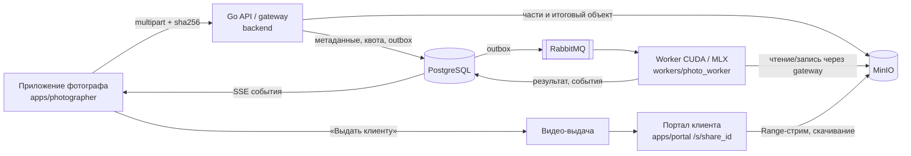

# Видеомонтаж в PhotoEditor — техническое задание на доработку

Дата: 2026-10-22. Статус: **спроектировано, не реализовано**. Документ — требования к доработке; код, миграции, контракты и тесты в рамках этой задачи не менялись и не запускались. Всё, что названо «новым» или «предлагаемым», ещё не существует в репозитории. Ссылки на существующие файлы проверены по дереву исходников 2026-10-22; наличие файла не доказывает его работоспособность или приёмку.

Основание: запрос владельца проекта — добавить в `apps/photographer` экраны для загрузки видеороликов, нелинейного монтажа из роликов, фото и музыки, цветокоррекции и поиска границ склеек моделями; тяжёлую работу выполнять асинхронно в `workers` на CUDA/MLX; хранить всё в MinIO; считать входной и выходной объём в общую квоту пользователя; раздавать готовые ролики клиентам через `apps/portal` по аналогии с фотосессиями.

## Сквозной конвейер

Этапы: **загрузка** → **ingest** (probe, proxy, раскадровка, волна, проверка целостности) → **монтаж** (таймлайн хранится как неизменяемые ревизии JSON) → **асинхронные задания** (поиск границ склеек, цветоанализ, превью-кадры, финальный рендер) → **результат в MinIO** → **выдача клиенту** через портал. Каждый байт исходников, производных и результатов попадает в единую квоту хранилища; каждая отдача клиенту — в квоту исходящего трафика.

## Состав ТЗ

| № | Документ | Содержание |
|---|---|---|
| 01 | [Продукт и сценарии](01-product-and-flows.md) | роли, сценарии, форматы, лимиты, функциональные требования `VID-F-*` |
| 02 | [Архитектура](02-architecture.md) | компоненты, последовательности, карта «как сделано сейчас → как делаем для видео», новые модули |
| 03 | [Экраны приложения фотографа](03-photographer-screens.md) | 12 новых экранов и 2 изменяемых, маршруты, файлы, Paper-компоненты, состояния, i18n, тесты `VID-UI-*` |
| 04 | [Данные и API](04-data-model-and-api.md) | таблицы, автоматы состояний, эндпоинты, события, ошибки `VID-D-*`, `VID-API-*` |
| 05 | [Хранилище, квоты, удаление](05-storage-quota-retention.md) | MinIO, загрузка, резервы, учёт входа/выхода/производных, трафик `VID-Q-*` |
| 06 | [Воркеры и модели](06-workers-and-models.md) | операции, CUDA/MLX, модели, ресурсные профили, прогресс, отмена `VID-W-*` |
| 07 | [Таймлайн и рендер](07-timeline-edl-and-render-spec.md) | формат документа монтажа, эффекты, компиляция в граф рендера `VID-T-*` |
| 08 | [Выдача и портал](08-delivery-portal.md) | ссылки клиентам, плеер, скачивание, отзыв `VID-SH-*` |
| 09 | [Безопасность и приватность](09-security-privacy.md) | недоверенные медиафайлы, изоляция, права, согласия, удаление `VID-SEC-*` |
| 10 | [План, приёмка, риски](10-testing-acceptance-rollout.md) | фазы, пакеты работ, тесты, метрики, открытые вопросы `VID-WP-*` |
| 11 | [Индекс артефактов](11-artifact-index.md) | все существующие файлы, на которые опирается ТЗ, и перечень новых/изменяемых |
| 12 | [Метод декомпозиции](12-decomposition-method.md) | уровни L0–L4, шаблон карточки, правила исполнителя со слабой моделью, порядок работ |
| 13 | [Структуры данных](13-data-structures.md) | константы, SQL DDL, типы TS/Python/Go, JSON по проводу, коды ошибок, события |
| 14 | [Каталог функций](14-function-catalog.md) | сигнатуры, порядок ошибок и алгоритмы 157 функций и 4 моделей |
| 15 | [Карточки задач](15-task-cards.md) | 130 атомарных задач `TK-nnn`: файлы, образцы, шаги, тесты, готовность, запреты |
| 16 | [Логика тестирования](16-test-logic.md) | слои, допуски, фикстуры, F1, SQL-конкурентность, интеграция, UI, безопасность, отчёт |
| 17 | [Приёмка и готовность](17-acceptance-and-dod.md) | чек-листы DoD, критерии `ACC-01…ACC-79`, матрица трассировки, формат отчёта |
| 18 | [Варианты использования](18-use-cases.md) | участники, окружение и фикстуры, `UC-01…UC-50`, матрица UC → ACC → E2E |
| 19 | [Потоки и сценарии e2e](19-user-flows-e2e.md) | карта переходов, соглашения (testID, ожидания), потоки `F-01…F-44`, сценарии `E2E-01…E2E-37`, отчёт |
| 20 | [Масштабирование SaaS и эксплуатация](20-saas-scaling-operations.md) | справедливость между арендаторами, лимиты и допуск, перегрузка, горячие пути БД, режимы доставки, SLO и метрики, готовность к шардированию, нагрузочные тесты; `VID-SC-01…19`, `ACC-41…56` |
| 21 | [Отчёт ревью](21-review-report.md) | вердикты (слабая модель, архитектура, SaaS), проверки, найденные дефекты R-01…R-34 и их исправления, открытые вопросы |
| 22 | [Инструменты, модели HF и лицензии](22-tools-models-licenses.md) | пять уровней проверки лицензий, политика `allow/conditional/review/deny`, реестр компонентов с источниками, решения D-17…D-23, LGPL-сборка ffmpeg, гейты SBOM и замка моделей, собственные веса детектора, что проверено и что нет |
| 23 | [Редактор: воспроизведение, таймлайн, команды](23-editor-playback-timeline.md) | состав кадра и переходы, автомат воспроизведения и Web Audio, ссылки воспроизведения, геометрия, хит-тест и жесты («жест → команда»), горячие клавиши, команды FN-T-15…28 с обратными, копирование и вставка клипа, колесо и трекпад, таймкод, оформление canvas, инспектор, колёса, кривые, осциллограммы; 404 вектора |
| — | [vectors/](vectors/README.md) | числовые векторы и эталонные скрипты для тестов |

## Ключевые решения (кратко)

| ID | Решение | Где обосновано |
|---|---|---|
| D-01 | Видео — отдельное семейство сущностей внутри существующего `project`: медиа (`video_media`), монтаж (`video_sequences` + неизменяемые ревизии), задания (`video_jobs` поверх существующих `runs`) | [02](02-architecture.md), [04](04-data-model-and-api.md) |
| D-02 | Загрузка — новый возобновляемый multipart-контракт для файлов до 16 ГиБ; текущий лимит клиента 512 МиБ (`upload.ts`) для видео не годится | [05](05-storage-quota-retention.md) |
| D-03 | Все вызовы моделей и ffmpeg — только в `workers`; клиент и Go API ничего не декодируют. Воркер читает и пишет объекты только через gateway, не напрямую в MinIO | [06](06-workers-and-models.md) |
| D-04 | Таймлайн — документ с версиями и CAS (`expected_revision`), как рецепт редактора; рендер читает **зафиксированную ревизию** и замороженный список источников | [07](07-timeline-edl-and-render-spec.md) |
| D-05 | Квота: оригиналы, производные (proxy, раскадровка, волна), результаты рендера и музыка считаются в одном `storage_bytes`; на время задания место **резервируется** | [05](05-storage-quota-retention.md) |
| D-06 | Бэкенды воркеров: `cuda` и **новый** `mlx` (рядом с существующими `cpu`, `cuda`, `mps`); каждая пара «модель × бэкенд» требует явного решения адаптера и квалификации, молчаливого отката на CPU нет | [06](06-workers-and-models.md) |
| D-07 | Выдача клиентам — через существующие `collections` + `share_links` + сессию портала; стриминг — аутентифицированный Range-прокси, скачивание — подписанные ссылки ≤ 60 с | [08](08-delivery-portal.md) |
| D-08 | До замера себестоимости видеообработка не продаётся и не входит в «одно фото»: capability-флаг, статус beta, учёт использования ведётся с первого дня | [05](05-storage-quota-retention.md), [10](10-testing-acceptance-rollout.md) |
| D-09…D-16 | Масштабирование SaaS: классы очереди и пулы, лимиты и суточный бюджет арендатора, перегрузка с `Retry-After`, горячие пути БД, режимы доставки, кэш исходника, предпросмотр | [20](20-saas-scaling-operations.md) |
| D-17…D-23 | Лицензии: пять уровней проверки, V1 без сторонних весов, собственные веса детектора, `numpy`-алгоритм темпа, LGPL-сборка ffmpeg, кодек и патенты, класс GPU | [22](22-tools-models-licenses.md) |
| D-24…D-36 | Редактор: поверхности только web без новых зависимостей, две колоды на дорожку и часы Web Audio, ссылки воспроизведения по Bearer, приблизительный предпросмотр, общее правило переходов и линейный звуковой кроссфейд, сглаживание фото, отмена снимками, состав команд, свои горячие клавиши | [23](23-editor-playback-timeline.md) |

## Что не входит в объём

Живая запись и стриминг, облачный многопользовательский монтаж в реальном времени, текстовые титры и шрифты, наложение видео поверх видео (PiP) и маски — в V2; распознавание лиц и людей в видео — вне объёма (биометрия); HDR end-to-end и 8K — вне V1; стоковая музыкальная библиотека — вне объёма (только музыка пользователя); публичная оплата видеообработки — после замеров.

## Установленные факты исходной точки

Подтверждены чтением исходников 2026-10-22 (подробнее — в [11](11-artifact-index.md)):

1. В репозитории **нет** видео-кода (поиск по ffmpeg/ffprobe/mp4 в `backend`, `workers`, `apps`, `packages` ничего не нашёл).
2. Клиентская загрузка [`upload.ts`](../../packages/api-client/src/upload.ts) ограничивает файл **512 МиБ**, часть **16 МиБ**, до 10 000 частей — для видео нужен отдельный контракт.
3. Рабочий протокол ограничивает задание: `TaskCommand.inputs ≤ 512`, `TaskResult.outputs ≤ 128`, для v2 — не более 127 прямых корней плюс манифест замыкания ([19-runtime-protocol.md](../implementation-v2/19-runtime-protocol.md)). Таймлайн с десятками клипов обязан идти через манифест замыкания.
4. Типовой воркер ограничен 20 ГиБ скачивания и загрузки на задание и 12 ГиБ scratch ([`compose.rtx-worker.yaml`](../../deploy/compose.rtx-worker.yaml)); для видео нужны отдельные профили.
5. Реестр операций [`operations.json`](../implementation-v2/contracts/operations.json) знает классы ресурсов `cpu` и `gpu`; бэкенды моделей — `cpu`, `cuda`, `mps` ([`backend_support.py`](../../workers/photo_worker/models/backend_support.py)). MLX отсутствует.
6. Ссылки на скачивание подписываются на срок не более 60 секунд ([collection-publication-contract.md](../implementation-v2/contracts/collection-publication-contract.md)); для видеостриминга нужна отдельная схема ([08](08-delivery-portal.md)).
7. `share_links` привязаны к `collection_id` ([00010_constraints_security.sql](../../backend/db/migrations/00010_constraints_security.sql)); выдача видео должна встроиться в эту модель.
8. Платный запуск требует B0–B4 из [billing-prelaunch-plan-2026-10-18.md](../implementation-v2/billing-prelaunch-plan-2026-10-18.md); тяжёлые операции нельзя включать в «одно фото» без измерений.
9. Паспорт UI приложения: все обычные элементы — React Native Paper; тест [`paper-ui-policy.test.ts`](../../apps/photographer/src/paper-ui-policy.test.ts) запрещает импорт `Text`, `TextInput`, `Button`, `Switch`, `Modal`, `Pressable`, `Touchable*`, `ActivityIndicator` из `react-native` ([контракт](../implementation-v2/photographer-paper-ui-contract.md)).

## Общие правила документа

- Идентификаторы требований: `VID-F` (функции), `VID-UI`, `VID-D` (данные), `VID-API`, `VID-Q` (квоты), `VID-W` (воркеры), `VID-T` (таймлайн), `VID-SH` (выдача), `VID-SEC`, `VID-WP` (пакеты работ). Каждое требование проверяемо; критерии приёмки — в [10](10-testing-acceptance-rollout.md).
- Числовые лимиты и целевые метрики — **стартовые значения для калибровки**, а не измеренные факты. Каждое выносится в настраиваемую политику (capability/capacity policy), а не в константу кода.
- Новые миграции продолжают нумерацию после `02650` и остаются forward-only, как существующие.
- Новые операции регистрируются в реестре операций и проходят квалификацию так же, как фото-операции; незавершённая операция недоступна и в UI показывается с причиной (правило из [mvp-web-release-plan-2026-10-20.md](../implementation-v2/mvp-web-release-plan-2026-10-20.md)).
- Все пользовательские строки — в трёх языках (EN/RU/BG) по существующему механизму локалей.

## Открытые вопросы владельцу продукта

Решения, влияющие на объём работ; рекомендуемый вариант указан в каждом пункте. Полный список с последствиями — в [10](10-testing-acceptance-rollout.md#открытые-вопросы).

| № | Вопрос | Рекомендация |
|---|---|---|
| Q-01 | Считать ли proxy/раскадровку/волну в квоту пользователя | Считать (в духе «общий объём»), показывать раздельно |
| Q-02 | Максимальный размер и длительность исходника в V1 | 16 ГиБ, 3 часа, до 4096×2304 |
| Q-03 | Лицензия FFmpeg-сборки (GPL libx264 или LGPL + аппаратные кодеки) и патентные отчисления H.264/HEVC | В эксплуатации только LGPL-сборка с аппаратными кодировщиками; `libx264` — лишь в профиле `gpl_internal` (внутренние образы и CI), [22](22-tools-models-licenses.md); юридическая проверка до выпуска |
| Q-04 | Нужен ли ввод HDR (HLG/PQ) в V1 | Принимать, но тонально отображать в Rec.709 с предупреждением |
| Q-05 | Музыка: достаточно ли файлов пользователя с декларацией прав | Да; стоковая библиотека — отдельный проект |
| Q-06 | Стриминг клиенту: прокси через backend (V1) или CDN (V2) | Прокси в V1 |
| Q-16 | Выходной кодек по умолчанию и патентные условия H.264; нужны ли VP9/AV1 | H.264 через аппаратные кодировщики в V1; беспатентные VP9/AV1 — V2; решает юрист |
| Q-17 | Класс GPU и драйвера воркеров (лицензия GeForce запрещает развёртывание в дата-центре) | Не включать потребительские карты в `video_heavy` до решения; решает владелец эксплуатации и юрист |
